# Herta DB 設計書（ER図・テーブル定義・CRUD）v1.1

- 文書ID: DOC-HERTA-DB-001
- 版: v1.1.0
- 状態: Current（生成物）
- 生成元: `ivRooom/Herta` の `packages/db/prisma/schema.prisma`（ファイル SHA `0eb4ef721bf953e145bbe8243aaf0be942982a8a`、1,580行）を 2026-11-10 に全文取得して生成。main の commit は初版生成時の `bd6cbabb` から `d9d1c48c` へ進んだが、schema.prisma 自体に変更はない（SHA 一致で確認）。手書き転記ではなく schema からの機械的抽出を基に編集
- 最終更新 / Last Reviewed: 2026-11-10 / 承認者: 未（Phase 4 で repo 配置時に承認）

## 現在の状態

- Prisma model **80件**（全て @@map でテーブル名を明示）、フィールド総数 **821件**、enum **1件**（VcRecapSessionStatus）。
- 実 DB（PG17 `herta`）は復元検証で **101テーブル**が確認されている。schema の80との差分21は `_prisma_migrations` 等の管理テーブルと、schema から削除済みの旧テーブルの残存が候補だが、**内訳は未検証**（実 DB のテーブル一覧との突合が次の照合タスク）。
- 明示 `@relation`（実 FK）を持つ model は34件（@relation の総数は37件）。残りは guildId / userId 等のスカラー列による**論理参照**で、DB レベルの FK 制約は無い。ER図では実 FK を実線、論理参照は本書では省略し各テーブルの備考で扱う。
- 状態系フィールド（名前に status を含む列）は17件あり、enum 化されているのは VcRecapSession.status（VcRecapSessionStatus）のみで、他は String。デフォルト値は `@default` が指定されたフィールドにのみ存在する（status では17件中12件）。デフォルトのない status は必須であり、event_rsvps.status と daily_bonus_claims.status（いずれも String、デフォルトなし）を含め、登録時に値を明示する必要がある。
- 複合外部キー（複合 FK）は6件ある。参照元・参照先の列ペアは「複合外部キー（複合 FK）一覧」に明記した。

## ER図（主要リレーションのみ、実 FK）

```mermaid
erDiagram
  guilds ||--o{ guild_members : "所属"
  users ||--o{ guild_members : "所属"
  guilds ||--o{ roles : "保持"
  guild_members ||--o{ user_roles : "割当"
  roles ||--o{ user_roles : "割当"
  guilds ||--o{ guild_plugins : "導入"
  plugins ||--o{ guild_plugins : "導入"
  guild_plugins ||--o{ guild_plugin_config_history : "履歴"
  guilds ||--o{ rules : "保持"
  rules ||--o{ rule_execution_logs : "実行"
  guilds ||--o| guild_settings : "設定"
  guilds ||--o{ audit_logs : "記録"
  guilds ||--o{ moderation_detection_events : "検出"
  auto_responses ||--o{ auto_response_execution_events : "実行"
  lfg_posts ||--o{ lfg_participants : "参加"
  team_split_sessions ||--o{ team_split_participants : "参加"
  daily_contents ||--o{ daily_content_deliveries : "配信"
  community_events ||--o{ event_rsvps : "申込"
  community_season_snapshots ||--o{ community_season_snapshot_entries : "明細"
  studio_access_groups ||--o{ studio_access_group_members : "所属"
  studio_access_policies ||--o{ studio_access_policy_attachments : "付属"
  vc_recap_sessions ||--o{ vc_recap_transcript_segments : "発話"
  guilds ||--o{ vc_recap_sessions : "開催"
  guilds ||--o{ daily_bonus_claims : "受取"
  guilds ||--o{ daily_fortune_results : "結果"
  guilds ||--o{ valorant_pick_sessions : "開催"
  valorant_pick_sessions ||--o{ valorant_pick_participants : "参加"
  valorant_pick_sessions ||--o| valorant_match_results : "結果"
  valorant_rosters ||--o{ valorant_agents : "構成"
```

## テーブル一覧（80件）

| テーブル                          | model                         | フィールド数 | 領域           |
| --------------------------------- | ----------------------------- | ------------ | -------------- |
| guilds                            | Guild                         | 28           | コア           |
| users                             | User                          | 11           | コア           |
| guild_members                     | GuildMember                   | 8            | コア           |
| roles                             | Role                          | 9            | コア           |
| user_roles                        | UserRole                      | 7            | コア           |
| guild_settings                    | GuildSettings                 | 10           | コア           |
| audit_logs                        | AuditLog                      | 14           | コア           |
| birthday_card_backgrounds         | BirthdayCardBackground        | 12           | Daily/誕生日   |
| birthday_card_assets              | BirthdayCardAsset             | 15           | Daily/誕生日   |
| valorant_rosters                  | ValorantRoster                | 4            | Valorant       |
| valorant_agents                   | ValorantAgent                 | 8            | Valorant       |
| command_execution_events          | CommandExecutionEvent         | 8            | 分析イベント   |
| ai_generation_events              | AiGenerationEvent             | 14           | AI             |
| ai_guild_monthly_budget_usage     | AiGuildMonthlyBudgetUsage     | 3            | AI             |
| ai_user_model_preferences         | AiUserModelPreference         | 5            | AI             |
| mbti_quiz_result_events           | MbtiQuizResultEvent           | 9            | MBTI           |
| mbti_question_answer_events       | MbtiQuestionAnswerEvent       | 7            | MBTI           |
| mbti_web_quiz_sessions            | MbtiWebQuizSession            | 13           | MBTI           |
| mbti_personal_results             | MbtiPersonalResult            | 12           | MBTI           |
| mbti_result_access                | MbtiResultAccess              | 4            | MBTI           |
| plugins                           | Plugin                        | 10           | プラグイン     |
| guild_plugins                     | GuildPlugin                   | 10           | プラグイン     |
| guild_plugin_config_history       | GuildPluginConfigHistory      | 9            | プラグイン     |
| rules                             | Rule                          | 19           | ルール         |
| rule_execution_logs               | RuleExecutionLog              | 10           | ルール         |
| service_health_snapshots          | ServiceHealthSnapshot         | 15           | 運用           |
| community_activity_daily          | CommunityActivityDaily        | 6            | コミュニティ   |
| community_voice_sessions          | CommunityVoiceSession         | 5            | コミュニティ   |
| community_activity_channel_daily  | CommunityActivityChannelDaily | 7            | コミュニティ   |
| community_presence_sessions       | CommunityPresenceSession      | 4            | コミュニティ   |
| community_game_sessions           | CommunityGameSession          | 5            | コミュニティ   |
| community_game_activity_daily     | CommunityGameActivityDaily    | 6            | コミュニティ   |
| achievement_unlocks               | AchievementUnlock             | 4            | コミュニティ   |
| community_profile_preferences     | CommunityProfilePreference    | 6            | コミュニティ   |
| community_challenge_assignments   | CommunityChallengeAssignment  | 5            | コミュニティ   |
| community_challenge_completions   | CommunityChallengeCompletion  | 8            | コミュニティ   |
| community_season_snapshots        | CommunitySeasonSnapshot       | 9            | コミュニティ   |
| community_season_snapshot_entries | CommunitySeasonSnapshotEntry  | 7            | コミュニティ   |
| auto_responses                    | AutoResponse                  | 22           | モデレーション |
| auto_response_execution_events    | AutoResponseExecutionEvent    | 8            | モデレーション |
| mod_actions                       | ModAction                     | 10           | モデレーション |
| word_filters                      | WordFilter                    | 14           | モデレーション |
| spam_settings                     | SpamSettings                  | 9            | モデレーション |
| moderation_settings               | ModerationSettings            | 10           | モデレーション |
| moderation_detection_events       | ModerationDetectionEvent      | 20           | モデレーション |
| moderation_blacklist_entries      | ModerationBlacklistEntry      | 8            | モデレーション |
| quotes                            | Quote                         | 16           | コンテンツ     |
| lfg_posts                         | LfgPost                       | 23           | コンテンツ     |
| lfg_participants                  | LfgParticipant                | 8            | コンテンツ     |
| team_split_sessions               | TeamSplitSession              | 27           | コンテンツ     |
| team_split_participants           | TeamSplitParticipant          | 9            | コンテンツ     |
| daily_contents                    | DailyContent                  | 23           | コンテンツ     |
| daily_content_deliveries          | DailyContentDelivery          | 18           | コンテンツ     |
| community_events                  | CommunityEvent                | 22           | コンテンツ     |
| event_rsvps                       | EventRsvp                     | 6            | コンテンツ     |
| studio_user_preferences           | StudioUserPreference          | 4            | Studio         |
| bot_presence_settings             | BotPresenceSetting            | 6            | Studio/運用    |
| studio_access_policies            | StudioAccessPolicy            | 11           | Studio         |
| studio_access_groups              | StudioAccessGroup             | 9            | Studio         |
| studio_access_group_members       | StudioAccessGroupMember       | 6            | Studio         |
| studio_access_policy_attachments  | StudioAccessPolicyAttachment  | 8            | Studio         |
| runtime_secrets                   | RuntimeSecret                 | 8            | 運用           |
| valorant_account_links            | ValorantAccountLink           | 7            | Valorant       |
| member_activity_events            | MemberActivityEvent           | 10           | 分析イベント   |
| fortune_profiles                  | FortuneProfile                | 10           | Daily/占い     |
| user_data_consents                | UserDataConsent               | 4            | 同意/VC Recap  |
| vc_recap_explicit_consents        | VcRecapExplicitConsent        | 6            | 同意/VC Recap  |
| vc_recap_erasure_requests         | VcRecapErasureRequest         | 4            | 同意/VC Recap  |
| vc_recap_storage_objects          | VcRecapStorageObject          | 11           | VC Recap       |
| voice_consent_access              | VoiceConsentAccess            | 3            | 同意/VC Recap  |
| vc_recap_sessions                 | VcRecapSession                | 14           | VC Recap       |
| vc_recap_transcript_segments      | VcRecapTranscriptSegment      | 8            | VC Recap       |
| daily_bonus_announcements         | DailyBonusAnnouncement        | 12           | Daily          |
| daily_bonus_claims                | DailyBonusClaim               | 8            | Daily          |
| anniversary_events                | DailyAnniversaryEvent         | 19           | Daily          |
| daily_bonus_quiz_sessions         | DailyBonusQuizSession         | 8            | Daily          |
| daily_fortune_results             | DailyFortuneResult            | 7            | Daily          |
| valorant_pick_sessions            | ValorantPickSession           | 21           | Valorant       |
| valorant_pick_participants        | ValorantPickParticipant       | 4            | Valorant       |
| valorant_match_results            | ValorantMatchResult           | 14           | Valorant       |

enum: `VcRecapSessionStatus` = active / summarizing / completed / failed（VcRecapSession.status、既定 active。実 DB の enum 型名は `vc_recap_session_status`）

## テーブル定義（全80件、フィールド詳細）

表記: 各テーブルごとに全フィールドを載せる。「フィールド（Prisma）」は Prisma フィールド名、「型」は Prisma 型（`?` は NULL 可、末尾の `[]` は配列）、「実列名（DB）」は実際の DB 列名（`@map` の値。`@map` が無いフィールドはフィールド名と同一になる）、「属性」は `@id` / `@unique` / `@default(...)` の値 / `@updatedAt` / `@db.*` のネイティブ型と、外部キー（FK）の参照先。
リレーションフィールドは実列を持たないため、実列名を「—（実列なし）」とし、属性の先頭に「リレーション」と明記した。FK を保持する側のリレーションには `@relation` の対応（参照元フィールド → 参照先テーブル.参照先列（実列名））と削除時・更新時の挙動を併記し、複合 FK の場合はその旨も明記した。逆参照のリレーションは「逆参照（実列なし）」と示した。

### 複合外部キー（複合 FK）一覧

| 参照元テーブル                    | 参照元列（実列名）   | 参照先テーブル             | 参照先列（実列名）   | onDelete | onUpdate |
| --------------------------------- | -------------------- | -------------------------- | -------------------- | -------- | -------- |
| user_roles                        | guild_id, user_id    | guild_members              | guild_id, user_id    | Cascade  | —        |
| guild_plugin_config_history       | guild_id, plugin_id  | guild_plugins              | guild_id, plugin_id  | Cascade  | —        |
| community_season_snapshot_entries | guild_id, season_key | community_season_snapshots | guild_id, season_key | Cascade  | —        |
| studio_access_group_members       | group_id, guild_id   | studio_access_groups       | id, guild_id         | Cascade  | Cascade  |
| studio_access_policy_attachments  | policy_id, guild_id  | studio_access_policies     | id, guild_id         | Cascade  | Cascade  |
| valorant_match_results            | session_id, guild_id | valorant_pick_sessions     | id, guild_id         | Cascade  | —        |

### コア

#### guilds（model: Guild）

- 主キー: `id`（@id）

| フィールド（Prisma）    | 型                         | 実列名（DB）  | 属性                              |
| ----------------------- | -------------------------- | ------------- | --------------------------------- |
| id                      | String                     | id            | @id                               |
| name                    | String                     | name          | —                                 |
| icon                    | String?                    | icon          | —                                 |
| ownerId                 | String?                    | owner_id      | —                                 |
| plan                    | String                     | plan          | @default("free")                  |
| locale                  | String                     | locale        | @default("ja")                    |
| timezone                | String                     | timezone      | @default("Asia/Tokyo")            |
| features                | Json                       | features      | @default("[]")                    |
| createdAt               | DateTime                   | created_at    | @default(now())                   |
| updatedAt               | DateTime                   | updated_at    | @updatedAt                        |
| settings                | GuildSettings?             | —（実列なし） | リレーション / 逆参照（実列なし） |
| birthdayCardBackground  | BirthdayCardBackground?    | —（実列なし） | リレーション / 逆参照（実列なし） |
| birthdayCardAssets      | BirthdayCardAsset[]        | —（実列なし） | リレーション / 逆参照（実列なし） |
| fortuneProfiles         | FortuneProfile[]           | —（実列なし） | リレーション / 逆参照（実列なし） |
| dailyBonusAnnouncements | DailyBonusAnnouncement[]   | —（実列なし） | リレーション / 逆参照（実列なし） |
| dailyBonusClaims        | DailyBonusClaim[]          | —（実列なし） | リレーション / 逆参照（実列なし） |
| anniversaryEvents       | DailyAnniversaryEvent[]    | —（実列なし） | リレーション / 逆参照（実列なし） |
| dailyBonusQuizSessions  | DailyBonusQuizSession[]    | —（実列なし） | リレーション / 逆参照（実列なし） |
| dailyFortuneResults     | DailyFortuneResult[]       | —（実列なし） | リレーション / 逆参照（実列なし） |
| members                 | GuildMember[]              | —（実列なし） | リレーション / 逆参照（実列なし） |
| roles                   | Role[]                     | —（実列なし） | リレーション / 逆参照（実列なし） |
| auditLogs               | AuditLog[]                 | —（実列なし） | リレーション / 逆参照（実列なし） |
| guildPlugins            | GuildPlugin[]              | —（実列なし） | リレーション / 逆参照（実列なし） |
| rules                   | Rule[]                     | —（実列なし） | リレーション / 逆参照（実列なし） |
| moderationDetections    | ModerationDetectionEvent[] | —（実列なし） | リレーション / 逆参照（実列なし） |
| vcRecapSessions         | VcRecapSession[]           | —（実列なし） | リレーション / 逆参照（実列なし） |
| valorantRoster          | ValorantRoster?            | —（実列なし） | リレーション / 逆参照（実列なし） |
| valorantPickSessions    | ValorantPickSession[]      | —（実列なし） | リレーション / 逆参照（実列なし） |

#### users（model: User）

- 主キー: `id`（@id）

| フィールド（Prisma） | 型                    | 実列名（DB）  | 属性                              |
| -------------------- | --------------------- | ------------- | --------------------------------- |
| id                   | String                | id            | @id                               |
| username             | String                | username      | —                                 |
| discriminator        | String?               | discriminator | —                                 |
| avatar               | String?               | avatar        | —                                 |
| email                | String?               | email         | —                                 |
| locale               | String?               | locale        | —                                 |
| isAdmin              | Boolean               | is_admin      | @default(false)                   |
| createdAt            | DateTime              | created_at    | @default(now())                   |
| updatedAt            | DateTime              | updated_at    | @updatedAt                        |
| memberships          | GuildMember[]         | —（実列なし） | リレーション / 逆参照（実列なし） |
| studioPreference     | StudioUserPreference? | —（実列なし） | リレーション / 逆参照（実列なし） |

#### guild_members（model: GuildMember）

- 主キー: `guildId`、`userId`（@@id、複合主キー）

| フィールド（Prisma） | 型         | 実列名（DB）  | 属性                                                                                          |
| -------------------- | ---------- | ------------- | --------------------------------------------------------------------------------------------- |
| guildId              | String     | guild_id      | FK → guilds.id                                                                                |
| userId               | String     | user_id       | FK → users.id                                                                                 |
| nickname             | String?    | nickname      | —                                                                                             |
| joinedAt             | DateTime?  | joined_at     | —                                                                                             |
| roles                | String[]   | roles         | —                                                                                             |
| guild                | Guild      | —（実列なし） | リレーション / @relation(fields → 参照先列（実列名）: guildId → guilds.id, onDelete: Cascade) |
| user                 | User       | —（実列なし） | リレーション / @relation(fields → 参照先列（実列名）: userId → users.id, onDelete: Cascade)   |
| userRoles            | UserRole[] | —（実列なし） | リレーション / 逆参照（実列なし）                                                             |

#### roles（model: Role）

- 主キー: `id`（@id）

| フィールド（Prisma） | 型         | 実列名（DB）  | 属性                                                                                          |
| -------------------- | ---------- | ------------- | --------------------------------------------------------------------------------------------- |
| id                   | String     | id            | @id / @default(uuid())                                                                        |
| guildId              | String     | guild_id      | FK → guilds.id                                                                                |
| name                 | String     | name          | —                                                                                             |
| permissions          | String[]   | permissions   | —                                                                                             |
| isDefault            | Boolean    | is_default    | @default(false)                                                                               |
| position             | Int        | position      | @default(0)                                                                                   |
| createdAt            | DateTime   | created_at    | @default(now())                                                                               |
| guild                | Guild      | —（実列なし） | リレーション / @relation(fields → 参照先列（実列名）: guildId → guilds.id, onDelete: Cascade) |
| userRoles            | UserRole[] | —（実列なし） | リレーション / 逆参照（実列なし）                                                             |

#### user_roles（model: UserRole）

- 主キー: `guildId`、`userId`、`roleId`（@@id、複合主キー）

| フィールド（Prisma） | 型          | 実列名（DB）  | 属性                                                                                                                                                  |
| -------------------- | ----------- | ------------- | ----------------------------------------------------------------------------------------------------------------------------------------------------- |
| guildId              | String      | guild_id      | FK → guild_members.guild_id（複合 FK の一部）                                                                                                         |
| userId               | String      | user_id       | FK → guild_members.user_id（複合 FK の一部）                                                                                                          |
| roleId               | String      | role_id       | FK → roles.id                                                                                                                                         |
| assignedBy           | String?     | assigned_by   | —                                                                                                                                                     |
| assignedAt           | DateTime    | assigned_at   | @default(now())                                                                                                                                       |
| member               | GuildMember | —（実列なし） | リレーション / @relation(fields → 参照先列（実列名）: guildId → guild_members.guild_id, userId → guild_members.user_id, onDelete: Cascade)（複合 FK） |
| role                 | Role        | —（実列なし） | リレーション / @relation(fields → 参照先列（実列名）: roleId → roles.id, onDelete: Cascade)                                                           |

#### guild_settings（model: GuildSettings）

- 主キー: `guildId`（@id）

| フィールド（Prisma） | 型       | 実列名（DB）   | 属性                                                                                          |
| -------------------- | -------- | -------------- | --------------------------------------------------------------------------------------------- |
| guildId              | String   | guild_id       | @id / FK → guilds.id                                                                          |
| prefix               | String   | prefix         | @default("!")                                                                                 |
| logChannelId         | String?  | log_channel_id | —                                                                                             |
| modRoleIds           | String[] | mod_role_ids   | —                                                                                             |
| adminRoleIds         | String[] | admin_role_ids | —                                                                                             |
| locale               | String   | locale         | @default("ja")                                                                                |
| settingsJson         | Json     | settings_json  | @default("{}")                                                                                |
| version              | Int      | version        | @default(1)                                                                                   |
| updatedAt            | DateTime | updated_at     | @updatedAt                                                                                    |
| guild                | Guild    | —（実列なし）  | リレーション / @relation(fields → 参照先列（実列名）: guildId → guilds.id, onDelete: Cascade) |

#### audit_logs（model: AuditLog）

- 主キー: `id`（@id）
- インデックス: `@@index([guildId, createdAt(sort: Desc)])` / `@@index([guildId, event])` / `@@index([guildId, actorId])` / `@@index([guildId, targetType, targetId, createdAt(sort: Desc), id(sort: Desc)], map: "audit_logs_guild_target_created_id_idx")`

| フィールド（Prisma） | 型       | 実列名（DB）  | 属性                                                                                          |
| -------------------- | -------- | ------------- | --------------------------------------------------------------------------------------------- |
| id                   | String   | id            | @id / @default(uuid())                                                                        |
| guildId              | String   | guild_id      | FK → guilds.id                                                                                |
| actorId              | String   | actor_id      | —                                                                                             |
| actorType            | String   | actor_type    | @default("user")                                                                              |
| event                | String   | event         | —                                                                                             |
| targetType           | String?  | target_type   | —                                                                                             |
| targetId             | String?  | target_id     | —                                                                                             |
| changes              | Json?    | changes       | —                                                                                             |
| metadata             | Json?    | metadata      | —                                                                                             |
| severity             | String   | severity      | @default("info")                                                                              |
| ipAddress            | String?  | ip_address    | —                                                                                             |
| sessionId            | String?  | session_id    | —                                                                                             |
| createdAt            | DateTime | created_at    | @default(now())                                                                               |
| guild                | Guild    | —（実列なし） | リレーション / @relation(fields → 参照先列（実列名）: guildId → guilds.id, onDelete: Cascade) |

### Daily/誕生日

#### birthday_card_backgrounds（model: BirthdayCardBackground）

- 主キー: `guildId`（@id）

| フィールド（Prisma） | 型       | 実列名（DB）  | 属性                                                                                                             |
| -------------------- | -------- | ------------- | ---------------------------------------------------------------------------------------------------------------- |
| guildId              | String   | guild_id      | @id / FK → guilds.id                                                                                             |
| contentType          | String   | content_type  | @db.VarChar(32)                                                                                                  |
| fileName             | String   | file_name     | @db.VarChar(120)                                                                                                 |
| content              | Bytes    | content       | —                                                                                                                |
| sizeBytes            | Int      | size_bytes    | —                                                                                                                |
| width                | Int      | width         | —                                                                                                                |
| height               | Int      | height        | —                                                                                                                |
| sha256               | String   | sha256        | @db.Char(64)                                                                                                     |
| updatedBy            | String   | updated_by    | —                                                                                                                |
| createdAt            | DateTime | created_at    | @default(now()) / @db.Timestamptz(3)                                                                             |
| updatedAt            | DateTime | updated_at    | @updatedAt / @db.Timestamptz(3)                                                                                  |
| guild                | Guild    | —（実列なし） | リレーション / @relation(fields → 参照先列（実列名）: guildId → guilds.id, onDelete: Cascade, onUpdate: Cascade) |

#### birthday_card_assets（model: BirthdayCardAsset）

- 主キー: `id`（@id）
- インデックス: `@@index([guildId, isPreset(sort: Desc), updatedAt(sort: Desc)], map: "birthday_card_assets_guild_preset_updated_idx")` / `@@index([guildId, sha256], map: "birthday_card_assets_guild_sha256_idx")`

| フィールド（Prisma） | 型       | 実列名（DB）  | 属性                                                                                                             |
| -------------------- | -------- | ------------- | ---------------------------------------------------------------------------------------------------------------- |
| id                   | String   | id            | @id                                                                                                              |
| guildId              | String   | guild_id      | FK → guilds.id                                                                                                   |
| name                 | String   | name          | @db.VarChar(120)                                                                                                 |
| contentType          | String   | content_type  | @db.VarChar(32)                                                                                                  |
| content              | Bytes    | content       | —                                                                                                                |
| sizeBytes            | Int      | size_bytes    | —                                                                                                                |
| width                | Int      | width         | —                                                                                                                |
| height               | Int      | height        | —                                                                                                                |
| sha256               | String   | sha256        | @db.Char(64)                                                                                                     |
| isPreset             | Boolean  | is_preset     | @default(false)                                                                                                  |
| createdBy            | String   | created_by    | —                                                                                                                |
| updatedBy            | String   | updated_by    | —                                                                                                                |
| createdAt            | DateTime | created_at    | @default(now()) / @db.Timestamptz(3)                                                                             |
| updatedAt            | DateTime | updated_at    | @default(now()) / @updatedAt / @db.Timestamptz(3)                                                                |
| guild                | Guild    | —（実列なし） | リレーション / @relation(fields → 参照先列（実列名）: guildId → guilds.id, onDelete: Cascade, onUpdate: Cascade) |

### Valorant

#### valorant_rosters（model: ValorantRoster）

- 主キー: `guildId`（@id）

| フィールド（Prisma） | 型              | 実列名（DB）  | 属性                                                                                          |
| -------------------- | --------------- | ------------- | --------------------------------------------------------------------------------------------- |
| guildId              | String          | guild_id      | @id / FK → guilds.id                                                                          |
| createdAt            | DateTime        | created_at    | @default(now())                                                                               |
| guild                | Guild           | —（実列なし） | リレーション / @relation(fields → 参照先列（実列名）: guildId → guilds.id, onDelete: Cascade) |
| agents               | ValorantAgent[] | —（実列なし） | リレーション / 逆参照（実列なし）                                                             |

#### valorant_agents（model: ValorantAgent）

- 主キー: `guildId`、`agentId`（@@id、複合主キー）
- ユニーク制約: `@@unique([guildId, agentName])`
- インデックス: `@@index([guildId, enabled])`

| フィールド（Prisma） | 型             | 実列名（DB）  | 属性                                                                                                          |
| -------------------- | -------------- | ------------- | ------------------------------------------------------------------------------------------------------------- |
| guildId              | String         | guild_id      | FK → valorant_rosters.guild_id                                                                                |
| agentId              | String         | agent_id      | —                                                                                                             |
| agentName            | String         | agent_name    | —                                                                                                             |
| displayName          | String         | display_name  | —                                                                                                             |
| enabled              | Boolean        | enabled       | @default(true)                                                                                                |
| createdAt            | DateTime       | created_at    | @default(now())                                                                                               |
| updatedAt            | DateTime       | updated_at    | @updatedAt                                                                                                    |
| roster               | ValorantRoster | —（実列なし） | リレーション / @relation(fields → 参照先列（実列名）: guildId → valorant_rosters.guild_id, onDelete: Cascade) |

#### valorant_account_links（model: ValorantAccountLink）

- 主キー: `guildId`、`userId`（@@id、複合主キー）

| フィールド（Prisma） | 型       | 実列名（DB） | 属性                                 |
| -------------------- | -------- | ------------ | ------------------------------------ |
| guildId              | String   | guild_id     | —                                    |
| userId               | String   | user_id      | —                                    |
| riotName             | String   | riot_name    | @db.VarChar(16)                      |
| riotTag              | String   | riot_tag     | @db.VarChar(8)                       |
| region               | String   | region       | @db.VarChar(8)                       |
| linkedAt             | DateTime | linked_at    | @default(now()) / @db.Timestamptz(3) |
| updatedAt            | DateTime | updated_at   | @updatedAt / @db.Timestamptz(3)      |

#### valorant_pick_sessions（model: ValorantPickSession）

- 主キー: `id`（@id）
- ユニーク制約: `messageId`（@unique） / `@@unique([id, guildId])`
- インデックス: `@@index([guildId, status, expiresAt])` / `@@index([guildId, completedAt])`

| フィールド（Prisma） | 型                        | 実列名（DB）       | 属性                                                                                          |
| -------------------- | ------------------------- | ------------------ | --------------------------------------------------------------------------------------------- |
| id                   | String                    | id                 | @id / @default(uuid())                                                                        |
| guildId              | String                    | guild_id           | FK → guilds.id                                                                                |
| channelId            | String                    | channel_id         | —                                                                                             |
| messageId            | String?                   | message_id         | @unique                                                                                       |
| creatorId            | String                    | creator_id         | —                                                                                             |
| status               | String                    | status             | @default("OPEN") / @db.VarChar(16)                                                            |
| mode                 | String                    | mode               | @db.VarChar(16)                                                                               |
| mapId                | String?                   | map_id             | @db.VarChar(32)                                                                               |
| voiceChannelId       | String?                   | voice_channel_id   | —                                                                                             |
| optedOutUserIds      | String[]                  | opted_out_user_ids | @default([])                                                                                  |
| maxParticipants      | Int                       | max_participants   | @default(5)                                                                                   |
| expiresAt            | DateTime                  | expires_at         | @db.Timestamptz(3)                                                                            |
| completedAt          | DateTime?                 | completed_at       | @db.Timestamptz(3)                                                                            |
| rulesVersion         | String                    | rules_version      | @db.VarChar(32)                                                                               |
| candidates           | Json                      | candidates         | @default("[]")                                                                                |
| result               | Json?                     | result             | —                                                                                             |
| createdAt            | DateTime                  | created_at         | @default(now()) / @db.Timestamptz(3)                                                          |
| updatedAt            | DateTime                  | updated_at         | @updatedAt / @db.Timestamptz(3)                                                               |
| guild                | Guild                     | —（実列なし）      | リレーション / @relation(fields → 参照先列（実列名）: guildId → guilds.id, onDelete: Cascade) |
| participants         | ValorantPickParticipant[] | —（実列なし）      | リレーション / 逆参照（実列なし）                                                             |
| matchResult          | ValorantMatchResult?      | —（実列なし）      | リレーション / 逆参照（実列なし）                                                             |

#### valorant_pick_participants（model: ValorantPickParticipant）

- 主キー: `sessionId`、`userId`（@@id、複合主キー）

| フィールド（Prisma） | 型                  | 実列名（DB）  | 属性                                                                                                            |
| -------------------- | ------------------- | ------------- | --------------------------------------------------------------------------------------------------------------- |
| sessionId            | String              | session_id    | FK → valorant_pick_sessions.id                                                                                  |
| userId               | String              | user_id       | —                                                                                                               |
| joinedAt             | DateTime            | joined_at     | @default(now()) / @db.Timestamptz(3)                                                                            |
| session              | ValorantPickSession | —（実列なし） | リレーション / @relation(fields → 参照先列（実列名）: sessionId → valorant_pick_sessions.id, onDelete: Cascade) |

#### valorant_match_results（model: ValorantMatchResult）

- 主キー: `id`（@id）
- ユニーク制約: `sessionId`（@unique） / `@@unique([sessionId, guildId])` / `@@unique([guildId, matchId])`
- インデックス: `@@index([guildId, createdAt])`

| フィールド（Prisma） | 型                  | 実列名（DB）   | 属性                                                                                                                                                                  |
| -------------------- | ------------------- | -------------- | --------------------------------------------------------------------------------------------------------------------------------------------------------------------- |
| id                   | String              | id             | @id / @default(uuid())                                                                                                                                                |
| sessionId            | String              | session_id     | @unique / FK → valorant_pick_sessions.id（複合 FK の一部）                                                                                                            |
| guildId              | String              | guild_id       | FK → valorant_pick_sessions.guild_id（複合 FK の一部）                                                                                                                |
| mapId                | String              | map_id         | @db.VarChar(32)                                                                                                                                                       |
| matchId              | String?             | match_id       | @db.VarChar(128)                                                                                                                                                      |
| source               | String              | source         | @default("MANUAL") / @db.VarChar(12)                                                                                                                                  |
| outcome              | String              | outcome        | @db.VarChar(8)                                                                                                                                                        |
| roundsWon            | Int                 | rounds_won     | —                                                                                                                                                                     |
| roundsLost           | Int                 | rounds_lost    | —                                                                                                                                                                     |
| playerResults        | Json                | player_results | @default("[]")                                                                                                                                                        |
| enteredBy            | String              | entered_by     | —                                                                                                                                                                     |
| createdAt            | DateTime            | created_at     | @default(now()) / @db.Timestamptz(3)                                                                                                                                  |
| updatedAt            | DateTime            | updated_at     | @updatedAt / @db.Timestamptz(3)                                                                                                                                       |
| session              | ValorantPickSession | —（実列なし）  | リレーション / @relation(fields → 参照先列（実列名）: sessionId → valorant_pick_sessions.id, guildId → valorant_pick_sessions.guild_id, onDelete: Cascade)（複合 FK） |

### 分析イベント

#### command_execution_events（model: CommandExecutionEvent）

- 主キー: `id`（@id）
- インデックス: `@@index([executedAt(sort: Desc)])` / `@@index([commandName, executedAt(sort: Desc)])` / `@@index([guildId, executedAt(sort: Desc)])` / `@@index([userId, executedAt(sort: Desc)])`

| フィールド（Prisma） | 型       | 実列名（DB） | 属性                                 |
| -------------------- | -------- | ------------ | ------------------------------------ |
| id                   | String   | id           | @id                                  |
| guildId              | String?  | guild_id     | —                                    |
| userId               | String?  | user_id      | —                                    |
| commandName          | String   | command_name | —                                    |
| status               | String   | status       | —                                    |
| durationMs           | Int      | duration_ms  | —                                    |
| errorName            | String?  | error_name   | —                                    |
| executedAt           | DateTime | executed_at  | @default(now()) / @db.Timestamptz(3) |

#### member_activity_events（model: MemberActivityEvent）

- 主キー: `id`（@id）
- インデックス: `@@index([guildId, occurredAt(sort: Desc)])` / `@@index([guildId, userId, occurredAt(sort: Desc)])` / `@@index([guildId, event, occurredAt(sort: Desc)])`

| フィールド（Prisma） | 型        | 実列名（DB）        | 属性                                 |
| -------------------- | --------- | ------------------- | ------------------------------------ |
| id                   | String    | id                  | @id / @default(uuid())               |
| guildId              | String    | guild_id            | —                                    |
| userId               | String?   | user_id             | —                                    |
| event                | String    | event               | @db.VarChar(32)                      |
| channelId            | String?   | channel_id          | —                                    |
| messageId            | String?   | message_id          | —                                    |
| content              | String?   | content             | —                                    |
| contentScrubbedAt    | DateTime? | content_scrubbed_at | @db.Timestamptz(3)                   |
| metadata             | Json?     | metadata            | —                                    |
| occurredAt           | DateTime  | occurred_at         | @default(now()) / @db.Timestamptz(3) |

### AI

#### ai_generation_events（model: AiGenerationEvent）

- 主キー: `id`（@id）
- インデックス: `@@index([occurredAt(sort: Desc)])` / `@@index([provider, occurredAt(sort: Desc)])` / `@@index([guildId, occurredAt(sort: Desc)])`

| フィールド（Prisma） | 型       | 実列名（DB）       | 属性                                 |
| -------------------- | -------- | ------------------ | ------------------------------------ |
| id                   | String   | id                 | @id                                  |
| guildId              | String   | guild_id           | —                                    |
| provider             | String   | provider           | —                                    |
| model                | String   | model              | —                                    |
| modelProfile         | String   | model_profile      | —                                    |
| feature              | String   | feature            | —                                    |
| resultCategory       | String   | result_category    | —                                    |
| errorCategory        | String?  | error_category     | —                                    |
| inputTokens          | Int      | input_tokens       | —                                    |
| outputTokens         | Int      | output_tokens      | —                                    |
| totalTokens          | Int      | total_tokens       | —                                    |
| estimatedCostUsd     | Float    | estimated_cost_usd | —                                    |
| durationMs           | Int      | duration_ms        | —                                    |
| occurredAt           | DateTime | occurred_at        | @default(now()) / @db.Timestamptz(3) |

#### ai_guild_monthly_budget_usage（model: AiGuildMonthlyBudgetUsage）

- 主キー: `guildId`、`periodStart`（@@id、複合主キー）

| フィールド（Prisma） | 型       | 実列名（DB）       | 属性               |
| -------------------- | -------- | ------------------ | ------------------ |
| guildId              | String   | guild_id           | —                  |
| periodStart          | DateTime | period_start       | @db.Timestamptz(3) |
| reservedMicroUsd     | BigInt   | reserved_micro_usd | @default(0)        |

#### ai_user_model_preferences（model: AiUserModelPreference）

- 主キー: `guildId`、`userId`（@@id、複合主キー）

| フィールド（Prisma） | 型       | 実列名（DB）  | 属性                            |
| -------------------- | -------- | ------------- | ------------------------------- |
| guildId              | String   | guild_id      | —                               |
| userId               | String   | user_id       | —                               |
| provider             | String   | provider      | @db.VarChar(16)                 |
| modelProfile         | String   | model_profile | @db.VarChar(16)                 |
| updatedAt            | DateTime | updated_at    | @updatedAt / @db.Timestamptz(3) |

### MBTI

#### mbti_quiz_result_events（model: MbtiQuizResultEvent）

- 主キー: `id`（@id）
- インデックス: `@@index([completedAt(sort: Desc)])` / `@@index([guildId, completedAt(sort: Desc)])` / `@@index([resultType, completedAt(sort: Desc)])`

| フィールド（Prisma） | 型       | 実列名（DB）  | 属性                                 |
| -------------------- | -------- | ------------- | ------------------------------------ |
| id                   | String   | id            | @id                                  |
| completionId         | String   | completion_id | —                                    |
| guildId              | String   | guild_id      | —                                    |
| resultType           | String   | result_type   | —                                    |
| eiScore              | Int      | ei_score      | —                                    |
| snScore              | Int      | sn_score      | —                                    |
| tfScore              | Int      | tf_score      | —                                    |
| jpScore              | Int      | jp_score      | —                                    |
| completedAt          | DateTime | completed_at  | @default(now()) / @db.Timestamptz(3) |

#### mbti_question_answer_events（model: MbtiQuestionAnswerEvent）

- 主キー: `id`（@id）
- インデックス: `@@index([completionId])` / `@@index([guildId, answeredAt(sort: Desc)])` / `@@index([questionIndex, answer])`

| フィールド（Prisma） | 型       | 実列名（DB）   | 属性                                 |
| -------------------- | -------- | -------------- | ------------------------------------ |
| id                   | String   | id             | @id                                  |
| completionId         | String   | completion_id  | —                                    |
| guildId              | String   | guild_id       | —                                    |
| questionIndex        | Int      | question_index | —                                    |
| axis                 | String   | axis           | —                                    |
| answer               | String   | answer         | —                                    |
| answeredAt           | DateTime | answered_at    | @default(now()) / @db.Timestamptz(3) |

#### mbti_web_quiz_sessions（model: MbtiWebQuizSession）

- 主キー: `id`（@id）
- インデックス: `@@index([guildId, discordUserId, status])` / `@@index([status, expiresAt])`

| フィールド（Prisma） | 型        | 実列名（DB）    | 属性                                 |
| -------------------- | --------- | --------------- | ------------------------------------ |
| id                   | String    | id              | @id / @default(uuid())               |
| guildId              | String    | guild_id        | —                                    |
| discordUserId        | String    | discord_user_id | —                                    |
| status               | String    | status          | @default("pending")                  |
| questionOrder        | Json      | question_order  | —                                    |
| answers              | Json      | answers         | @default("[]")                       |
| scores               | Json      | scores          | @default("{}")                       |
| resultType           | String?   | result_type     | —                                    |
| resultIdentity       | String?   | result_identity | —                                    |
| completedAt          | DateTime? | completed_at    | @db.Timestamptz(3)                   |
| expiresAt            | DateTime  | expires_at      | @db.Timestamptz(3)                   |
| createdAt            | DateTime  | created_at      | @default(now()) / @db.Timestamptz(3) |
| updatedAt            | DateTime  | updated_at      | @updatedAt / @db.Timestamptz(3)      |

#### mbti_personal_results（model: MbtiPersonalResult）

- 主キー: `id`（@id）
- ユニーク制約: `completionKey`（@unique）
- インデックス: `@@index([guildId, discordUserId, completedAt(sort: Desc), id(sort: Desc)])`

| フィールド（Prisma） | 型       | 実列名（DB）    | 属性                   |
| -------------------- | -------- | --------------- | ---------------------- |
| id                   | String   | id              | @id / @default(uuid()) |
| completionKey        | String   | completion_key  | @unique                |
| guildId              | String   | guild_id        | —                      |
| discordUserId        | String   | discord_user_id | —                      |
| resultType           | String   | result_type     | —                      |
| resultIdentity       | String   | result_identity | —                      |
| scores               | Json     | scores          | —                      |
| percentages          | Json     | percentages     | —                      |
| questionCount        | Int      | question_count  | —                      |
| scoringVersion       | String   | scoring_version | —                      |
| source               | String   | source          | —                      |
| completedAt          | DateTime | completed_at    | @db.Timestamptz(3)     |

#### mbti_result_access（model: MbtiResultAccess）

- 主キー: `guildId`、`discordUserId`（@@id、複合主キー）
- ユニーク制約: `tokenHash`（@unique）

| フィールド（Prisma） | 型       | 実列名（DB）    | 属性               |
| -------------------- | -------- | --------------- | ------------------ |
| guildId              | String   | guild_id        | —                  |
| discordUserId        | String   | discord_user_id | —                  |
| tokenHash            | String   | token_hash      | @unique            |
| expiresAt            | DateTime | expires_at      | @db.Timestamptz(3) |

### プラグイン

#### plugins（model: Plugin）

- 主キー: `id`（@id）

| フィールド（Prisma） | 型            | 実列名（DB）  | 属性                              |
| -------------------- | ------------- | ------------- | --------------------------------- |
| id                   | String        | id            | @id                               |
| name                 | String        | name          | —                                 |
| description          | String?       | description   | —                                 |
| version              | String        | version       | —                                 |
| author               | String?       | author        | —                                 |
| category             | String?       | category      | —                                 |
| isOfficial           | Boolean       | is_official   | @default(false)                   |
| manifest             | Json          | manifest      | —                                 |
| createdAt            | DateTime      | created_at    | @default(now())                   |
| guildPlugins         | GuildPlugin[] | —（実列なし） | リレーション / 逆参照（実列なし） |

#### guild_plugins（model: GuildPlugin）

- 主キー: `guildId`、`pluginId`（@@id、複合主キー）

| フィールド（Prisma） | 型                         | 実列名（DB）   | 属性                                                                                          |
| -------------------- | -------------------------- | -------------- | --------------------------------------------------------------------------------------------- |
| guildId              | String                     | guild_id       | FK → guilds.id                                                                                |
| pluginId             | String                     | plugin_id      | FK → plugins.id                                                                               |
| enabled              | Boolean                    | enabled        | @default(true)                                                                                |
| config               | Json                       | config         | @default("{}")                                                                                |
| configVersion        | Int                        | config_version | @default(1)                                                                                   |
| installedAt          | DateTime                   | installed_at   | @default(now())                                                                               |
| updatedAt            | DateTime                   | updated_at     | @updatedAt                                                                                    |
| guild                | Guild                      | —（実列なし）  | リレーション / @relation(fields → 参照先列（実列名）: guildId → guilds.id, onDelete: Cascade) |
| plugin               | Plugin                     | —（実列なし）  | リレーション / @relation(fields → 参照先列（実列名）: pluginId → plugins.id)                  |
| configHistory        | GuildPluginConfigHistory[] | —（実列なし）  | リレーション / 逆参照（実列なし）                                                             |

#### guild_plugin_config_history（model: GuildPluginConfigHistory）

- 主キー: `id`（@id）

| フィールド（Prisma） | 型          | 実列名（DB）  | 属性                                                                                                                                                      |
| -------------------- | ----------- | ------------- | --------------------------------------------------------------------------------------------------------------------------------------------------------- |
| id                   | String      | id            | @id / @default(uuid())                                                                                                                                    |
| guildId              | String      | guild_id      | FK → guild_plugins.guild_id（複合 FK の一部）                                                                                                             |
| pluginId             | String      | plugin_id     | FK → guild_plugins.plugin_id（複合 FK の一部）                                                                                                            |
| version              | Int         | version       | —                                                                                                                                                         |
| config               | Json        | config        | —                                                                                                                                                         |
| changedBy            | String      | changed_by    | —                                                                                                                                                         |
| changeReason         | String?     | change_reason | —                                                                                                                                                         |
| createdAt            | DateTime    | created_at    | @default(now())                                                                                                                                           |
| guildPlugin          | GuildPlugin | —（実列なし） | リレーション / @relation(fields → 参照先列（実列名）: guildId → guild_plugins.guild_id, pluginId → guild_plugins.plugin_id, onDelete: Cascade)（複合 FK） |

### ルール

#### rules（model: Rule）

- 主キー: `id`（@id）
- インデックス: `@@index([guildId, enabled])`

| フィールド（Prisma） | 型                 | 実列名（DB）    | 属性                                                                                          |
| -------------------- | ------------------ | --------------- | --------------------------------------------------------------------------------------------- |
| id                   | String             | id              | @id / @default(uuid())                                                                        |
| guildId              | String             | guild_id        | FK → guilds.id                                                                                |
| pluginId             | String?            | plugin_id       | —                                                                                             |
| name                 | String             | name            | —                                                                                             |
| description          | String?            | description     | —                                                                                             |
| enabled              | Boolean            | enabled         | @default(true)                                                                                |
| priority             | Int                | priority        | @default(0)                                                                                   |
| schemaVersion        | Int                | schema_version  | @default(1)                                                                                   |
| trigger              | Json               | trigger         | —                                                                                             |
| conditions           | Json               | conditions      | @default("[]")                                                                                |
| actions              | Json               | actions         | @default("[]")                                                                                |
| cooldownMs           | Int                | cooldown_ms     | @default(0)                                                                                   |
| maxExecutions        | Int?               | max_executions  | —                                                                                             |
| executionCount       | Int                | execution_count | @default(0)                                                                                   |
| createdBy            | String             | created_by      | —                                                                                             |
| createdAt            | DateTime           | created_at      | @default(now())                                                                               |
| updatedAt            | DateTime           | updated_at      | @updatedAt                                                                                    |
| guild                | Guild              | —（実列なし）   | リレーション / @relation(fields → 参照先列（実列名）: guildId → guilds.id, onDelete: Cascade) |
| executionLogs        | RuleExecutionLog[] | —（実列なし）   | リレーション / 逆参照（実列なし）                                                             |

#### rule_execution_logs（model: RuleExecutionLog）

- 主キー: `id`（@id）
- インデックス: `@@index([guildId, executedAt(sort: Desc)])`

| フィールド（Prisma） | 型       | 実列名（DB）   | 属性                                                                                        |
| -------------------- | -------- | -------------- | ------------------------------------------------------------------------------------------- |
| id                   | String   | id             | @id / @default(uuid())                                                                      |
| ruleId               | String   | rule_id        | FK → rules.id                                                                               |
| guildId              | String   | guild_id       | —                                                                                           |
| triggerEvent         | Json     | trigger_event  | —                                                                                           |
| conditionsMet        | Boolean  | conditions_met | —                                                                                           |
| actionsResult        | Json?    | actions_result | —                                                                                           |
| error                | String?  | error          | —                                                                                           |
| durationMs           | Int?     | duration_ms    | —                                                                                           |
| executedAt           | DateTime | executed_at    | @default(now())                                                                             |
| rule                 | Rule     | —（実列なし）  | リレーション / @relation(fields → 参照先列（実列名）: ruleId → rules.id, onDelete: Cascade) |

### 運用

#### service_health_snapshots（model: ServiceHealthSnapshot）

- 主キー: `id`（@id）
- インデックス: `@@index([serviceId, checkedAt(sort: Desc)])` / `@@index([checkedAt(sort: Desc)])`

| フィールド（Prisma） | 型       | 実列名（DB）        | 属性                                 |
| -------------------- | -------- | ------------------- | ------------------------------------ |
| id                   | String   | id                  | @id / @default(uuid()) / @db.Uuid    |
| serviceId            | String   | service_id          | —                                    |
| version              | String   | version             | —                                    |
| status               | String   | status              | —                                    |
| discordStatus        | String   | discord_status      | —                                    |
| databaseStatus       | String   | database_status     | —                                    |
| redisStatus          | String   | redis_status        | —                                    |
| workerStatus         | String   | worker_status       | —                                    |
| databaseLatencyMs    | Int?     | database_latency_ms | —                                    |
| redisLatencyMs       | Int?     | redis_latency_ms    | —                                    |
| workerLatencyMs      | Int?     | worker_latency_ms   | —                                    |
| guildCount           | Int      | guild_count         | @default(0)                          |
| uptimeSeconds        | Int      | uptime_seconds      | @default(0)                          |
| checkedAt            | DateTime | checked_at          | @db.Timestamptz(3)                   |
| createdAt            | DateTime | created_at          | @default(now()) / @db.Timestamptz(3) |

#### runtime_secrets（model: RuntimeSecret）

- 主キー: `name`（@id）

| フィールド（Prisma） | 型       | 実列名（DB） | 属性                                              |
| -------------------- | -------- | ------------ | ------------------------------------------------- |
| name                 | String   | name         | @id / @db.VarChar(100)                            |
| ciphertext           | Bytes    | ciphertext   | —                                                 |
| iv                   | Bytes    | iv           | —                                                 |
| authTag              | Bytes    | auth_tag     | —                                                 |
| keyVersion           | Int      | key_version  | @default(1)                                       |
| updatedBy            | String   | updated_by   | @db.VarChar(128)                                  |
| createdAt            | DateTime | created_at   | @default(now()) / @db.Timestamptz(3)              |
| updatedAt            | DateTime | updated_at   | @default(now()) / @updatedAt / @db.Timestamptz(3) |

### コミュニティ

#### community_activity_daily（model: CommunityActivityDaily）

- 主キー: `guildId`、`userId`、`activityDate`、`metric`（@@id、複合主キー）
- インデックス: `@@index([guildId, metric, activityDate])` / `@@index([guildId, userId, activityDate])`

| フィールド（Prisma） | 型       | 実列名（DB）  | 属性                            |
| -------------------- | -------- | ------------- | ------------------------------- |
| guildId              | String   | guild_id      | —                               |
| userId               | String   | user_id       | —                               |
| activityDate         | DateTime | activity_date | @db.Date                        |
| metric               | String   | metric        | @db.VarChar(32)                 |
| value                | BigInt   | value         | @default(0)                     |
| updatedAt            | DateTime | updated_at    | @updatedAt / @db.Timestamptz(3) |

#### community_voice_sessions（model: CommunityVoiceSession）

- 主キー: `guildId`、`userId`（@@id、複合主キー）
- インデックス: `@@index([guildId, startedAt])`

| フィールド（Prisma） | 型       | 実列名（DB） | 属性                            |
| -------------------- | -------- | ------------ | ------------------------------- |
| guildId              | String   | guild_id     | —                               |
| userId               | String   | user_id      | —                               |
| channelId            | String   | channel_id   | —                               |
| startedAt            | DateTime | started_at   | @db.Timestamptz(3)              |
| updatedAt            | DateTime | updated_at   | @updatedAt / @db.Timestamptz(3) |

#### community_activity_channel_daily（model: CommunityActivityChannelDaily）

- 主キー: `guildId`、`channelId`、`userId`、`activityDate`、`metric`（@@id、複合主キー）
- インデックス: `@@index([guildId, channelId, metric, activityDate])` / `@@index([guildId, metric, activityDate])`

| フィールド（Prisma） | 型       | 実列名（DB）  | 属性                            |
| -------------------- | -------- | ------------- | ------------------------------- |
| guildId              | String   | guild_id      | —                               |
| channelId            | String   | channel_id    | —                               |
| userId               | String   | user_id       | —                               |
| activityDate         | DateTime | activity_date | @db.Date                        |
| metric               | String   | metric        | @db.VarChar(32)                 |
| value                | BigInt   | value         | @default(0)                     |
| updatedAt            | DateTime | updated_at    | @updatedAt / @db.Timestamptz(3) |

#### community_presence_sessions（model: CommunityPresenceSession）

- 主キー: `guildId`、`userId`（@@id、複合主キー）
- インデックス: `@@index([guildId, startedAt])`

| フィールド（Prisma） | 型       | 実列名（DB） | 属性                            |
| -------------------- | -------- | ------------ | ------------------------------- |
| guildId              | String   | guild_id     | —                               |
| userId               | String   | user_id      | —                               |
| startedAt            | DateTime | started_at   | @db.Timestamptz(3)              |
| updatedAt            | DateTime | updated_at   | @updatedAt / @db.Timestamptz(3) |

#### community_game_sessions（model: CommunityGameSession）

- 主キー: `guildId`、`userId`（@@id、複合主キー）
- インデックス: `@@index([guildId, startedAt])`

| フィールド（Prisma） | 型       | 実列名（DB）  | 属性                            |
| -------------------- | -------- | ------------- | ------------------------------- |
| guildId              | String   | guild_id      | —                               |
| userId               | String   | user_id       | —                               |
| activityName         | String   | activity_name | @db.VarChar(128)                |
| startedAt            | DateTime | started_at    | @db.Timestamptz(3)              |
| updatedAt            | DateTime | updated_at    | @updatedAt / @db.Timestamptz(3) |

#### community_game_activity_daily（model: CommunityGameActivityDaily）

- 主キー: `guildId`、`userId`、`activityName`、`activityDate`（@@id、複合主キー）
- インデックス: `@@index([guildId, activityName, activityDate])`

| フィールド（Prisma） | 型       | 実列名（DB）  | 属性                            |
| -------------------- | -------- | ------------- | ------------------------------- |
| guildId              | String   | guild_id      | —                               |
| userId               | String   | user_id       | —                               |
| activityName         | String   | activity_name | @db.VarChar(128)                |
| activityDate         | DateTime | activity_date | @db.Date                        |
| value                | BigInt   | value         | @default(0)                     |
| updatedAt            | DateTime | updated_at    | @updatedAt / @db.Timestamptz(3) |

#### achievement_unlocks（model: AchievementUnlock）

- 主キー: `guildId`、`userId`、`achievementId`（@@id、複合主キー）
- インデックス: `@@index([guildId, userId, unlockedAt(sort: Desc)])` / `@@index([guildId, achievementId, unlockedAt(sort: Desc)])`

| フィールド（Prisma） | 型       | 実列名（DB）   | 属性                                 |
| -------------------- | -------- | -------------- | ------------------------------------ |
| guildId              | String   | guild_id       | —                                    |
| userId               | String   | user_id        | —                                    |
| achievementId        | String   | achievement_id | —                                    |
| unlockedAt           | DateTime | unlocked_at    | @default(now()) / @db.Timestamptz(3) |

#### community_profile_preferences（model: CommunityProfilePreference）

- 主キー: `guildId`、`userId`（@@id、複合主キー）
- インデックス: `@@index([guildId, isPublic])`

| フィールド（Prisma）   | 型       | 実列名（DB）             | 属性                            |
| ---------------------- | -------- | ------------------------ | ------------------------------- |
| guildId                | String   | guild_id                 | —                               |
| userId                 | String   | user_id                  | —                               |
| isPublic               | Boolean  | is_public                | @default(true)                  |
| featuredAchievementIds | String[] | featured_achievement_ids | @default([])                    |
| titleAchievementId     | String?  | title_achievement_id     | —                               |
| updatedAt              | DateTime | updated_at               | @updatedAt / @db.Timestamptz(3) |

#### community_challenge_assignments（model: CommunityChallengeAssignment）

- 主キー: `guildId`、`periodType`、`periodKey`（@@id、複合主キー）
- インデックス: `@@index([guildId, createdAt(sort: Desc)])`

| フィールド（Prisma） | 型       | 実列名（DB）  | 属性                                 |
| -------------------- | -------- | ------------- | ------------------------------------ |
| guildId              | String   | guild_id      | —                                    |
| periodType           | String   | period_type   | @db.VarChar(16)                      |
| periodKey            | String   | period_key    | @db.VarChar(32)                      |
| challengeIds         | String[] | challenge_ids | —                                    |
| createdAt            | DateTime | created_at    | @default(now()) / @db.Timestamptz(3) |

#### community_challenge_completions（model: CommunityChallengeCompletion）

- 主キー: `guildId`、`userId`、`challengeId`、`periodType`、`periodKey`（@@id、複合主キー）
- インデックス: `@@index([guildId, userId, completedAt(sort: Desc)])` / `@@index([guildId, seasonKey, points(sort: Desc)])` / `@@index([guildId, periodType, periodKey])`

| フィールド（Prisma） | 型       | 実列名（DB） | 属性                                 |
| -------------------- | -------- | ------------ | ------------------------------------ |
| guildId              | String   | guild_id     | —                                    |
| userId               | String   | user_id      | —                                    |
| challengeId          | String   | challenge_id | @db.VarChar(96)                      |
| periodType           | String   | period_type  | @db.VarChar(16)                      |
| periodKey            | String   | period_key   | @db.VarChar(32)                      |
| seasonKey            | String   | season_key   | @db.VarChar(32)                      |
| points               | Int      | points       | —                                    |
| completedAt          | DateTime | completed_at | @default(now()) / @db.Timestamptz(3) |

#### community_season_snapshots（model: CommunitySeasonSnapshot）

- 主キー: `guildId`、`seasonKey`（@@id、複合主キー）
- インデックス: `@@index([seasonKey, finalizedAt(sort: Desc)])`

| フィールド（Prisma） | 型                             | 実列名（DB）      | 属性                                 |
| -------------------- | ------------------------------ | ----------------- | ------------------------------------ |
| guildId              | String                         | guild_id          | —                                    |
| seasonKey            | String                         | season_key        | @db.VarChar(32)                      |
| seasonIndex          | Int                            | season_index      | —                                    |
| startsAt             | DateTime                       | starts_at         | @db.Timestamptz(3)                   |
| endsAt               | DateTime                       | ends_at           | @db.Timestamptz(3)                   |
| participantCount     | Int                            | participant_count | @default(0)                          |
| sourceVersion        | Int                            | source_version    | @default(1)                          |
| finalizedAt          | DateTime                       | finalized_at      | @default(now()) / @db.Timestamptz(3) |
| entries              | CommunitySeasonSnapshotEntry[] | —（実列なし）     | リレーション / 逆参照（実列なし）    |

#### community_season_snapshot_entries（model: CommunitySeasonSnapshotEntry）

- 主キー: `guildId`、`seasonKey`、`userId`（@@id、複合主キー）
- ユニーク制約: `@@unique([guildId, seasonKey, rank])`
- インデックス: `@@index([guildId, seasonKey, awardTier, rank])`

| フィールド（Prisma） | 型                      | 実列名（DB）  | 属性                                                                                                                                                                                  |
| -------------------- | ----------------------- | ------------- | ------------------------------------------------------------------------------------------------------------------------------------------------------------------------------------- |
| guildId              | String                  | guild_id      | FK → community_season_snapshots.guild_id（複合 FK の一部）                                                                                                                            |
| seasonKey            | String                  | season_key    | @db.VarChar(32) / FK → community_season_snapshots.season_key（複合 FK の一部）                                                                                                        |
| userId               | String                  | user_id       | —                                                                                                                                                                                     |
| rank                 | Int                     | rank          | —                                                                                                                                                                                     |
| points               | Int                     | points        | —                                                                                                                                                                                     |
| awardTier            | String?                 | award_tier    | @db.VarChar(16)                                                                                                                                                                       |
| snapshot             | CommunitySeasonSnapshot | —（実列なし） | リレーション / @relation(fields → 参照先列（実列名）: guildId → community_season_snapshots.guild_id, seasonKey → community_season_snapshots.season_key, onDelete: Cascade)（複合 FK） |

### モデレーション

#### auto_responses（model: AutoResponse）

- 主キー: `id`（@id）
- インデックス: `@@index([guildId, enabled])` / `@@index([guildId, priority(sort: Desc), createdAt])`

| フィールド（Prisma） | 型                           | 実列名（DB）      | 属性                              |
| -------------------- | ---------------------------- | ----------------- | --------------------------------- |
| id                   | String                       | id                | @id / @default(uuid())            |
| guildId              | String                       | guild_id          | —                                 |
| name                 | String                       | name              | —                                 |
| triggerType          | String                       | trigger_type      | —                                 |
| triggerValue         | String                       | trigger_value     | —                                 |
| matchMode            | String                       | match_mode        | @default("partial")               |
| responseType         | String                       | response_type     | @default("text")                  |
| responseContent      | String                       | response_content  | —                                 |
| channelIds           | String[]                     | channel_ids       | —                                 |
| roleIds              | String[]                     | role_ids          | —                                 |
| cooldownSeconds      | Int                          | cooldown_seconds  | @default(0)                       |
| priority             | Int                          | priority          | @default(0)                       |
| caseSensitive        | Boolean                      | case_sensitive    | @default(false)                   |
| responseCount        | Int                          | response_count    | @default(0)                       |
| failureCount         | Int                          | failure_count     | @default(0)                       |
| lastTriggeredAt      | DateTime?                    | last_triggered_at | @db.Timestamptz(3)                |
| enabled              | Boolean                      | enabled           | @default(true)                    |
| createdBy            | String?                      | created_by        | —                                 |
| updatedBy            | String?                      | updated_by        | —                                 |
| createdAt            | DateTime                     | created_at        | @default(now())                   |
| updatedAt            | DateTime                     | updated_at        | @updatedAt                        |
| executionEvents      | AutoResponseExecutionEvent[] | —（実列なし）     | リレーション / 逆参照（実列なし） |

#### auto_response_execution_events（model: AutoResponseExecutionEvent）

- 主キー: `id`（@id）
- インデックス: `@@index([executedAt(sort: Desc)])` / `@@index([guildId, executedAt(sort: Desc)])` / `@@index([ruleId, executedAt(sort: Desc)])` / `@@index([status, executedAt(sort: Desc)])`

| フィールド（Prisma） | 型           | 実列名（DB）  | 属性                                                                                                 |
| -------------------- | ------------ | ------------- | ---------------------------------------------------------------------------------------------------- |
| id                   | String       | id            | @id / @default(uuid())                                                                               |
| guildId              | String       | guild_id      | —                                                                                                    |
| ruleId               | String       | rule_id       | FK → auto_responses.id                                                                               |
| status               | String       | status        | —                                                                                                    |
| durationMs           | Int          | duration_ms   | —                                                                                                    |
| errorName            | String?      | error_name    | —                                                                                                    |
| executedAt           | DateTime     | executed_at   | @default(now()) / @db.Timestamptz(3)                                                                 |
| rule                 | AutoResponse | —（実列なし） | リレーション / @relation(fields → 参照先列（実列名）: ruleId → auto_responses.id, onDelete: Cascade) |

#### mod_actions（model: ModAction）

- 主キー: `id`（@id）
- インデックス: `@@index([guildId, targetId])`

| フィールド（Prisma） | 型        | 実列名（DB） | 属性                   |
| -------------------- | --------- | ------------ | ---------------------- |
| id                   | String    | id           | @id / @default(uuid()) |
| guildId              | String    | guild_id     | —                      |
| targetId             | String    | target_id    | —                      |
| moderatorId          | String    | moderator_id | —                      |
| actionType           | String    | action_type  | —                      |
| reason               | String?   | reason       | —                      |
| durationMs           | BigInt?   | duration_ms  | —                      |
| expiresAt            | DateTime? | expires_at   | —                      |
| active               | Boolean   | active       | @default(true)         |
| createdAt            | DateTime  | created_at   | @default(now())        |

#### word_filters（model: WordFilter）

- 主キー: `id`（@id）
- インデックス: `@@index([guildId, enabled])`

| フィールド（Prisma） | 型       | 実列名（DB）    | 属性                   |
| -------------------- | -------- | --------------- | ---------------------- |
| id                   | String   | id              | @id / @default(uuid()) |
| guildId              | String   | guild_id        | —                      |
| pattern              | String   | pattern         | —                      |
| patternType          | String   | pattern_type    | @default("exact")      |
| action               | String   | action          | @default("delete")     |
| reason               | String?  | reason          | —                      |
| caseSensitive        | Boolean  | case_sensitive  | @default(false)        |
| exemptRoles          | String[] | exempt_roles    | @default([])           |
| exemptChannels       | String[] | exempt_channels | @default([])           |
| enabled              | Boolean  | enabled         | @default(true)         |
| createdBy            | String?  | created_by      | —                      |
| updatedBy            | String?  | updated_by      | —                      |
| createdAt            | DateTime | created_at      | @default(now())        |
| updatedAt            | DateTime | updated_at      | @updatedAt             |

#### spam_settings（model: SpamSettings）

- 主キー: `guildId`（@id）

| フィールド（Prisma） | 型      | 実列名（DB）        | 属性                |
| -------------------- | ------- | ------------------- | ------------------- |
| guildId              | String  | guild_id            | @id                 |
| maxMessages          | Int     | max_messages        | @default(5)         |
| timeWindowMs         | Int     | time_window_ms      | @default(5000)      |
| maxMentions          | Int     | max_mentions        | @default(10)        |
| maxLinks             | Int     | max_links           | @default(3)         |
| duplicateThreshold   | Int     | duplicate_threshold | @default(3)         |
| action               | String  | action              | @default("timeout") |
| timeoutDurationMs    | BigInt  | timeout_duration_ms | @default(300000)    |
| enabled              | Boolean | enabled             | @default(true)      |

#### moderation_settings（model: ModerationSettings）

- 主キー: `guildId`（@id）

| フィールド（Prisma） | 型       | 実列名（DB）         | 属性               |
| -------------------- | -------- | -------------------- | ------------------ |
| guildId              | String   | guild_id             | @id                |
| enableWordFilter     | Boolean  | enable_word_filter   | @default(true)     |
| enableInviteFilter   | Boolean  | enable_invite_filter | @default(false)    |
| enableSpamFilter     | Boolean  | enable_spam_filter   | @default(true)     |
| logChannelId         | String?  | log_channel_id       | —                  |
| exemptRoles          | String[] | exempt_roles         | @default([])       |
| exemptChannels       | String[] | exempt_channels      | @default([])       |
| allowedInvites       | String[] | allowed_invites      | @default([])       |
| inviteAction         | String   | invite_action        | @default("delete") |
| updatedAt            | DateTime | updated_at           | @updatedAt         |

#### moderation_detection_events（model: ModerationDetectionEvent）

- 主キー: `id`（@id）
- ユニーク制約: `idempotencyKey`（@unique）
- インデックス: `@@index([guildId, occurredAt(sort: Desc)])` / `@@index([guildId, reviewStatus, occurredAt(sort: Desc)])` / `@@index([guildId, detectionKind, occurredAt(sort: Desc)])` / `@@index([guildId, userId, occurredAt(sort: Desc)])`

| フィールド（Prisma） | 型        | 実列名（DB）    | 属性                                                                                          |
| -------------------- | --------- | --------------- | --------------------------------------------------------------------------------------------- |
| id                   | String    | id              | @id / @default(uuid())                                                                        |
| guildId              | String    | guild_id        | FK → guilds.id                                                                                |
| messageId            | String    | message_id      | —                                                                                             |
| channelId            | String    | channel_id      | —                                                                                             |
| userId               | String    | user_id         | —                                                                                             |
| detectionKind        | String    | detection_kind  | —                                                                                             |
| mode                 | String    | mode            | @default("observe")                                                                           |
| messageLength        | Int       | message_length  | —                                                                                             |
| observedCount        | Int?      | observed_count  | —                                                                                             |
| threshold            | Int?      | threshold       | —                                                                                             |
| ruleIndex            | Int?      | rule_index      | —                                                                                             |
| idempotencyKey       | String    | idempotency_key | @unique                                                                                       |
| reviewStatus         | String    | review_status   | @default("unreviewed")                                                                        |
| reviewedBy           | String?   | reviewed_by     | —                                                                                             |
| reviewedAt           | DateTime? | reviewed_at     | @db.Timestamptz(3)                                                                            |
| reviewNote           | String?   | review_note     | —                                                                                             |
| occurredAt           | DateTime  | occurred_at     | @db.Timestamptz(3)                                                                            |
| createdAt            | DateTime  | created_at      | @default(now()) / @db.Timestamptz(3)                                                          |
| updatedAt            | DateTime  | updated_at      | @updatedAt / @db.Timestamptz(3)                                                               |
| guild                | Guild     | —（実列なし）   | リレーション / @relation(fields → 参照先列（実列名）: guildId → guilds.id, onDelete: Cascade) |

#### moderation_blacklist_entries（model: ModerationBlacklistEntry）

- 主キー: `guildId`、`userId`（@@id、複合主キー）
- インデックス: `@@index([guildId, active, createdAt(sort: Desc)])` / `@@index([userId])`

| フィールド（Prisma） | 型       | 実列名（DB）        | 属性                                 |
| -------------------- | -------- | ------------------- | ------------------------------------ |
| guildId              | String   | guild_id            | —                                    |
| userId               | String   | user_id             | —                                    |
| reason               | String?  | reason              | —                                    |
| originDetectionId    | String?  | origin_detection_id | @db.Uuid                             |
| createdBy            | String   | created_by          | —                                    |
| active               | Boolean  | active              | @default(true)                       |
| createdAt            | DateTime | created_at          | @default(now()) / @db.Timestamptz(3) |
| updatedAt            | DateTime | updated_at          | @updatedAt / @db.Timestamptz(3)      |

### コンテンツ

#### quotes（model: Quote）

- 主キー: `id`（@id）
- ユニーク制約: `@@unique([guildId, quoteNumber])`
- インデックス: `@@index([guildId, status])`

| フィールド（Prisma） | 型       | 実列名（DB）       | 属性                   |
| -------------------- | -------- | ------------------ | ---------------------- |
| id                   | String   | id                 | @id / @default(uuid()) |
| guildId              | String   | guild_id           | —                      |
| quoteNumber          | Int      | quote_number       | —                      |
| quoteText            | String   | quote_text         | —                      |
| sourceMessageId      | String?  | source_message_id  | —                      |
| sourceChannelId      | String?  | source_channel_id  | —                      |
| sourceMessageUrl     | String?  | source_message_url | —                      |
| sourceAuthorId       | String?  | source_author_id   | —                      |
| sourceAuthorName     | String?  | source_author_name | —                      |
| registeredById       | String   | registered_by_id   | —                      |
| registeredByName     | String   | registered_by_name | —                      |
| tags                 | String[] | tags               | @default([])           |
| status               | String   | status             | @default("public")     |
| isNsfw               | Boolean  | is_nsfw            | @default(false)        |
| createdAt            | DateTime | created_at         | @default(now())        |
| updatedAt            | DateTime | updated_at         | @updatedAt             |

#### lfg_posts（model: LfgPost）

- 主キー: `id`（@id）
- インデックス: `@@index([guildId, status])` / `@@index([guildId, channelId, status])` / `@@index([guildId, creatorId, createdAt(sort: Desc)])` / `@@index([status, expiresAt])`

| フィールド（Prisma） | 型               | 実列名（DB）      | 属性                                 |
| -------------------- | ---------------- | ----------------- | ------------------------------------ |
| id                   | String           | id                | @id / @default(uuid())               |
| guildId              | String           | guild_id          | —                                    |
| creatorId            | String           | creator_id        | —                                    |
| channelId            | String           | channel_id        | —                                    |
| messageId            | String?          | message_id        | —                                    |
| game                 | String           | game              | —                                    |
| title                | String           | title             | —                                    |
| description          | String           | description       | @default("")                         |
| maxPlayers           | Int              | max_players       | @default(5)                          |
| participantCount     | Int              | participant_count | @default(1)                          |
| startTime            | DateTime?        | start_time        | @db.Timestamptz(3)                   |
| expiresAt            | DateTime         | expires_at        | @db.Timestamptz(3)                   |
| status               | String           | status            | @default("open")                     |
| messageState         | String           | message_state     | @default("pending")                  |
| lastErrorName        | String?          | last_error_name   | —                                    |
| closedAt             | DateTime?        | closed_at         | @db.Timestamptz(3)                   |
| createdBy            | String?          | created_by        | —                                    |
| updatedBy            | String?          | updated_by        | —                                    |
| deletedAt            | DateTime?        | deleted_at        | @db.Timestamptz(3)                   |
| version              | Int              | version           | @default(1)                          |
| createdAt            | DateTime         | created_at        | @default(now()) / @db.Timestamptz(3) |
| updatedAt            | DateTime         | updated_at        | @updatedAt / @db.Timestamptz(3)      |
| participants         | LfgParticipant[] | —（実列なし）     | リレーション / 逆参照（実列なし）    |

#### lfg_participants（model: LfgParticipant）

- 主キー: `lfgId`、`userId`（@@id、複合主キー）
- インデックス: `@@index([guildId, status])`

| フィールド（Prisma） | 型        | 実列名（DB）  | 属性                                                                                           |
| -------------------- | --------- | ------------- | ---------------------------------------------------------------------------------------------- |
| lfgId                | String    | lfg_id        | FK → lfg_posts.id                                                                              |
| guildId              | String    | guild_id      | —                                                                                              |
| userId               | String    | user_id       | —                                                                                              |
| status               | String    | status        | @default("joined")                                                                             |
| joinedAt             | DateTime  | joined_at     | @default(now()) / @db.Timestamptz(3)                                                           |
| leftAt               | DateTime? | left_at       | @db.Timestamptz(3)                                                                             |
| updatedAt            | DateTime  | updated_at    | @updatedAt / @db.Timestamptz(3)                                                                |
| lfgPost              | LfgPost   | —（実列なし） | リレーション / @relation(fields → 参照先列（実列名）: lfgId → lfg_posts.id, onDelete: Cascade) |

#### team_split_sessions（model: TeamSplitSession）

- 主キー: `id`（@id）
- インデックス: `@@index([guildId, status])` / `@@index([guildId, channelId, status])` / `@@index([guildId, creatorId, createdAt(sort: Desc)])` / `@@index([status, expiresAt])`

| フィールド（Prisma） | 型                     | 実列名（DB）      | 属性                                 |
| -------------------- | ---------------------- | ----------------- | ------------------------------------ |
| id                   | String                 | id                | @id / @default(uuid())               |
| guildId              | String                 | guild_id          | —                                    |
| creatorId            | String                 | creator_id        | —                                    |
| channelId            | String                 | channel_id        | —                                    |
| messageId            | String?                | message_id        | —                                    |
| title                | String                 | title             | @default("Team Split")               |
| teamCount            | Int                    | team_count        | @default(2)                          |
| mode                 | String                 | mode              | @default("random")                   |
| maxParticipants      | Int                    | max_participants  | @default(20)                         |
| participantCount     | Int                    | participant_count | @default(0)                          |
| participants         | String[]               | participants      | @default([])                         |
| teams                | Json?                  | teams             | —                                    |
| seedHash             | String                 | seed_hash         | @default("")                         |
| generation           | Int                    | generation        | @default(0)                          |
| status               | String                 | status            | @default("open")                     |
| expiresAt            | DateTime               | expires_at        | @db.Timestamptz(3)                   |
| splitAt              | DateTime?              | split_at          | @db.Timestamptz(3)                   |
| closedAt             | DateTime?              | closed_at         | @db.Timestamptz(3)                   |
| messageState         | String                 | message_state     | @default("pending")                  |
| lastErrorName        | String?                | last_error_name   | —                                    |
| createdBy            | String?                | created_by        | —                                    |
| updatedBy            | String?                | updated_by        | —                                    |
| deletedAt            | DateTime?              | deleted_at        | @db.Timestamptz(3)                   |
| version              | Int                    | version           | @default(1)                          |
| createdAt            | DateTime               | created_at        | @default(now()) / @db.Timestamptz(3) |
| updatedAt            | DateTime               | updated_at        | @updatedAt / @db.Timestamptz(3)      |
| participantRecords   | TeamSplitParticipant[] | —（実列なし）     | リレーション / 逆参照（実列なし）    |

#### team_split_participants（model: TeamSplitParticipant）

- 主キー: `sessionId`、`userId`（@@id、複合主キー）
- インデックス: `@@index([guildId, status])`

| フィールド（Prisma） | 型               | 実列名（DB）  | 属性                                                                                                         |
| -------------------- | ---------------- | ------------- | ------------------------------------------------------------------------------------------------------------ |
| sessionId            | String           | session_id    | FK → team_split_sessions.id                                                                                  |
| guildId              | String           | guild_id      | —                                                                                                            |
| userId               | String           | user_id       | —                                                                                                            |
| score                | Int              | score         | @default(0)                                                                                                  |
| status               | String           | status        | @default("joined")                                                                                           |
| joinedAt             | DateTime         | joined_at     | @default(now()) / @db.Timestamptz(3)                                                                         |
| leftAt               | DateTime?        | left_at       | @db.Timestamptz(3)                                                                                           |
| updatedAt            | DateTime         | updated_at    | @updatedAt / @db.Timestamptz(3)                                                                              |
| session              | TeamSplitSession | —（実列なし） | リレーション / @relation(fields → 参照先列（実列名）: sessionId → team_split_sessions.id, onDelete: Cascade) |

#### daily_contents（model: DailyContent）

- 主キー: `id`（@id）
- インデックス: `@@index([guildId, enabled])` / `@@index([enabled, nextRunAt])` / `@@index([guildId, recurrenceType, nextRunAt])`

| フィールド（Prisma） | 型                     | 実列名（DB）         | 属性                                |
| -------------------- | ---------------------- | -------------------- | ----------------------------------- |
| id                   | String                 | id                   | @id / @default(uuid())              |
| guildId              | String                 | guild_id             | —                                   |
| channelId            | String                 | channel_id           | —                                   |
| title                | String                 | title                | @default("")                        |
| content              | String                 | content              | —                                   |
| scheduleTime         | String                 | schedule_time        | —                                   |
| timezone             | String                 | timezone             | @default("Asia/Tokyo")              |
| enabled              | Boolean                | enabled              | @default(true)                      |
| recurrenceType       | String                 | recurrence_type      | @default("daily") / @db.VarChar(16) |
| onceAt               | DateTime?              | once_at              | @db.Timestamptz(3)                  |
| weekdays             | Int[]                  | weekdays             | @default([])                        |
| messageFormat        | String                 | message_format       | @default("text") / @db.VarChar(16)  |
| embedJson            | Json?                  | embed_json           | —                                   |
| publishAnnouncement  | Boolean                | publish_announcement | @default(false)                     |
| nextRunAt            | DateTime?              | next_run_at          | @db.Timestamptz(3)                  |
| lastScheduledAt      | DateTime?              | last_scheduled_at    | @db.Timestamptz(3)                  |
| lastSentAt           | DateTime?              | last_sent_at         | @db.Timestamptz(3)                  |
| deletedAt            | DateTime?              | deleted_at           | @db.Timestamptz(3)                  |
| createdBy            | String?                | created_by           | —                                   |
| updatedBy            | String?                | updated_by           | —                                   |
| createdAt            | DateTime               | created_at           | @default(now())                     |
| updatedAt            | DateTime               | updated_at           | @updatedAt                          |
| deliveries           | DailyContentDelivery[] | —（実列なし）        | リレーション / 逆参照（実列なし）   |

#### daily_content_deliveries（model: DailyContentDelivery）

- 主キー: `id`（@id）
- ユニーク制約: `idempotencyKey`（@unique）
- インデックス: `@@index([guildId, createdAt(sort: Desc)])` / `@@index([status, nextAttemptAt])` / `@@index([dailyContentId, scheduledFor(sort: Desc)])`

| フィールド（Prisma） | 型           | 実列名（DB）     | 属性                                                                                                          |
| -------------------- | ------------ | ---------------- | ------------------------------------------------------------------------------------------------------------- |
| id                   | String       | id               | @id / @default(uuid())                                                                                        |
| dailyContentId       | String       | daily_content_id | FK → daily_contents.id                                                                                        |
| guildId              | String       | guild_id         | —                                                                                                             |
| idempotencyKey       | String       | idempotency_key  | @unique                                                                                                       |
| origin               | String       | origin           | @default("scheduled")                                                                                         |
| scheduledFor         | DateTime     | scheduled_for    | @db.Timestamptz(3)                                                                                            |
| status               | String       | status           | @default("pending")                                                                                           |
| attemptCount         | Int          | attempt_count    | @default(0)                                                                                                   |
| messageId            | String?      | message_id       | —                                                                                                             |
| errorName            | String?      | error_name       | —                                                                                                             |
| queuedAt             | DateTime?    | queued_at        | @db.Timestamptz(3)                                                                                            |
| startedAt            | DateTime?    | started_at       | @db.Timestamptz(3)                                                                                            |
| nextAttemptAt        | DateTime?    | next_attempt_at  | @db.Timestamptz(3)                                                                                            |
| sentAt               | DateTime?    | sent_at          | @db.Timestamptz(3)                                                                                            |
| failedAt             | DateTime?    | failed_at        | @db.Timestamptz(3)                                                                                            |
| createdAt            | DateTime     | created_at       | @default(now()) / @db.Timestamptz(3)                                                                          |
| updatedAt            | DateTime     | updated_at       | @updatedAt / @db.Timestamptz(3)                                                                               |
| dailyContent         | DailyContent | —（実列なし）    | リレーション / @relation(fields → 参照先列（実列名）: dailyContentId → daily_contents.id, onDelete: Restrict) |

#### community_events（model: CommunityEvent）

- 主キー: `id`（@id）
- インデックス: `@@index([guildId, startsAt])` / `@@index([guildId, status, registrationClosesAt])` / `@@index([guildId, creatorId, startsAt])` / `@@index([guildId, reminderSentAt, startsAt])`

| フィールド（Prisma） | 型          | 実列名（DB）           | 属性                                     |
| -------------------- | ----------- | ---------------------- | ---------------------------------------- |
| id                   | String      | id                     | @id / @default(uuid()) / @db.Uuid        |
| guildId              | String      | guild_id               | —                                        |
| creatorId            | String      | creator_id             | —                                        |
| channelId            | String      | channel_id             | —                                        |
| messageId            | String?     | message_id             | —                                        |
| title                | String      | title                  | @db.VarChar(200)                         |
| description          | String?     | description            | @db.VarChar(1000)                        |
| location             | String?     | location               | @db.VarChar(200)                         |
| timezone             | String      | timezone               | @default("Asia/Tokyo") / @db.VarChar(64) |
| startsAt             | DateTime    | starts_at              | @db.Timestamptz(3)                       |
| registrationClosesAt | DateTime    | registration_closes_at | @db.Timestamptz(3)                       |
| capacity             | Int?        | capacity               | —                                        |
| status               | String      | status                 | @default("open") / @db.VarChar(16)       |
| allowMaybe           | Boolean     | allow_maybe            | @default(true)                           |
| allowWaitlist        | Boolean     | allow_waitlist         | @default(true)                           |
| reminderMinutes      | Int         | reminder_minutes       | @default(60)                             |
| reminderSentAt       | DateTime?   | reminder_sent_at       | @db.Timestamptz(3)                       |
| reminderClaimedAt    | DateTime?   | reminder_claimed_at    | @db.Timestamptz(3)                       |
| finalizedAt          | DateTime?   | finalized_at           | @db.Timestamptz(3)                       |
| createdAt            | DateTime    | created_at             | @default(now()) / @db.Timestamptz(3)     |
| updatedAt            | DateTime    | updated_at             | @updatedAt / @db.Timestamptz(3)          |
| rsvps                | EventRsvp[] | —（実列なし）          | リレーション / 逆参照（実列なし）        |

#### event_rsvps（model: EventRsvp）

- 主キー: `eventId`、`userId`（@@id、複合主キー）
- インデックス: `@@index([eventId, status, createdAt])`

| フィールド（Prisma） | 型             | 実列名（DB）  | 属性                                                                                                    |
| -------------------- | -------------- | ------------- | ------------------------------------------------------------------------------------------------------- |
| eventId              | String         | event_id      | @db.Uuid / FK → community_events.id                                                                     |
| userId               | String         | user_id       | —                                                                                                       |
| status               | String         | status        | @db.VarChar(16)                                                                                         |
| createdAt            | DateTime       | created_at    | @default(now()) / @db.Timestamptz(3)                                                                    |
| updatedAt            | DateTime       | updated_at    | @updatedAt / @db.Timestamptz(3)                                                                         |
| event                | CommunityEvent | —（実列なし） | リレーション / @relation(fields → 参照先列（実列名）: eventId → community_events.id, onDelete: Cascade) |

### Studio

#### studio_user_preferences（model: StudioUserPreference）

- 主キー: `userId`（@id）

| フィールド（Prisma） | 型       | 実列名（DB）     | 属性                                                                                                           |
| -------------------- | -------- | ---------------- | -------------------------------------------------------------------------------------------------------------- |
| userId               | String   | user_id          | @id / FK → users.id                                                                                            |
| defaultGuildId       | String?  | default_guild_id | —                                                                                                              |
| updatedAt            | DateTime | updated_at       | @updatedAt / @db.Timestamptz(3)                                                                                |
| user                 | User     | —（実列なし）    | リレーション / @relation(fields → 参照先列（実列名）: userId → users.id, onDelete: Cascade, onUpdate: Cascade) |

#### studio_access_policies（model: StudioAccessPolicy）

- 主キー: `id`（@id）
- ユニーク制約: `@@unique([guildId, name])` / `@@unique([id, guildId])`
- インデックス: `@@index([guildId, updatedAt(sort: Desc)])`

| フィールド（Prisma） | 型                             | 実列名（DB）  | 属性                                 |
| -------------------- | ------------------------------ | ------------- | ------------------------------------ |
| id                   | String                         | id            | @id / @db.Uuid                       |
| guildId              | String                         | guild_id      | —                                    |
| name                 | String                         | name          | @db.VarChar(100)                     |
| description          | String?                        | description   | @db.VarChar(500)                     |
| document             | Json                           | document      | —                                    |
| revision             | Int                            | revision      | @default(1)                          |
| createdBy            | String                         | created_by    | —                                    |
| updatedBy            | String                         | updated_by    | —                                    |
| createdAt            | DateTime                       | created_at    | @default(now()) / @db.Timestamptz(3) |
| updatedAt            | DateTime                       | updated_at    | @updatedAt / @db.Timestamptz(3)      |
| attachments          | StudioAccessPolicyAttachment[] | —（実列なし） | リレーション / 逆参照（実列なし）    |

#### studio_access_groups（model: StudioAccessGroup）

- 主キー: `id`（@id）
- ユニーク制約: `@@unique([guildId, name])` / `@@unique([id, guildId])`
- インデックス: `@@index([guildId, updatedAt(sort: Desc)])`

| フィールド（Prisma） | 型                        | 実列名（DB）  | 属性                                 |
| -------------------- | ------------------------- | ------------- | ------------------------------------ |
| id                   | String                    | id            | @id / @db.Uuid                       |
| guildId              | String                    | guild_id      | —                                    |
| name                 | String                    | name          | @db.VarChar(100)                     |
| description          | String?                   | description   | @db.VarChar(500)                     |
| createdBy            | String                    | created_by    | —                                    |
| updatedBy            | String                    | updated_by    | —                                    |
| createdAt            | DateTime                  | created_at    | @default(now()) / @db.Timestamptz(3) |
| updatedAt            | DateTime                  | updated_at    | @updatedAt / @db.Timestamptz(3)      |
| members              | StudioAccessGroupMember[] | —（実列なし） | リレーション / 逆参照（実列なし）    |

#### studio_access_group_members（model: StudioAccessGroupMember）

- 主キー: `groupId`、`userId`（@@id、複合主キー）
- インデックス: `@@index([guildId, userId])`

| フィールド（Prisma） | 型                | 実列名（DB）  | 属性                                                                                                                                                                               |
| -------------------- | ----------------- | ------------- | ---------------------------------------------------------------------------------------------------------------------------------------------------------------------------------- |
| groupId              | String            | group_id      | @db.Uuid / FK → studio_access_groups.id（複合 FK の一部）                                                                                                                          |
| guildId              | String            | guild_id      | FK → studio_access_groups.guild_id（複合 FK の一部）                                                                                                                               |
| userId               | String            | user_id       | —                                                                                                                                                                                  |
| createdBy            | String            | created_by    | —                                                                                                                                                                                  |
| createdAt            | DateTime          | created_at    | @default(now()) / @db.Timestamptz(3)                                                                                                                                               |
| group                | StudioAccessGroup | —（実列なし） | リレーション / @relation(fields → 参照先列（実列名）: groupId → studio_access_groups.id, guildId → studio_access_groups.guild_id, onDelete: Cascade, onUpdate: Cascade)（複合 FK） |

#### studio_access_policy_attachments（model: StudioAccessPolicyAttachment）

- 主キー: `id`（@id）
- ユニーク制約: `@@unique([policyId, principalType, principalId])`
- インデックス: `@@index([guildId, principalType, principalId])` / `@@index([guildId, policyId])`

| フィールド（Prisma） | 型                 | 実列名（DB）   | 属性                                                                                                                                                                                    |
| -------------------- | ------------------ | -------------- | --------------------------------------------------------------------------------------------------------------------------------------------------------------------------------------- |
| id                   | String             | id             | @id / @db.Uuid                                                                                                                                                                          |
| policyId             | String             | policy_id      | @db.Uuid / FK → studio_access_policies.id（複合 FK の一部）                                                                                                                             |
| guildId              | String             | guild_id       | FK → studio_access_policies.guild_id（複合 FK の一部）                                                                                                                                  |
| principalType        | String             | principal_type | @db.VarChar(16)                                                                                                                                                                         |
| principalId          | String             | principal_id   | —                                                                                                                                                                                       |
| createdBy            | String             | created_by     | —                                                                                                                                                                                       |
| createdAt            | DateTime           | created_at     | @default(now()) / @db.Timestamptz(3)                                                                                                                                                    |
| policy               | StudioAccessPolicy | —（実列なし）  | リレーション / @relation(fields → 参照先列（実列名）: policyId → studio_access_policies.id, guildId → studio_access_policies.guild_id, onDelete: Cascade, onUpdate: Cascade)（複合 FK） |

### Studio/運用

#### bot_presence_settings（model: BotPresenceSetting）

- 主キー: `id`（@id）

| フィールド（Prisma） | 型       | 実列名（DB）  | 属性                            |
| -------------------- | -------- | ------------- | ------------------------------- |
| id                   | String   | id            | @id / @default("default")       |
| status               | String   | status        | @default("online")              |
| activityType         | String   | activity_type | @default("playing")             |
| activityText         | String   | activity_text | @default("Herta")               |
| updatedBy            | String?  | updated_by    | —                               |
| updatedAt            | DateTime | updated_at    | @updatedAt / @db.Timestamptz(3) |

### Daily/占い

#### fortune_profiles（model: FortuneProfile）

- 主キー: `guildId`、`userId`（@@id、複合主キー）

| フィールド（Prisma） | 型       | 実列名（DB）  | 属性                                                                                                              |
| -------------------- | -------- | ------------- | ----------------------------------------------------------------------------------------------------------------- |
| guildId              | String   | guild_id      | FK → guilds.id                                                                                                    |
| userId               | String   | user_id       | —                                                                                                                 |
| birthday             | String?  | birthday      | @db.VarChar(10)                                                                                                   |
| bloodType            | String?  | blood_type    | @db.VarChar(2)                                                                                                    |
| mbti                 | String?  | mbti          | @db.VarChar(6)                                                                                                    |
| zodiac               | String?  | zodiac        | @db.VarChar(8)                                                                                                    |
| ageGroup             | String?  | age_group     | @db.VarChar(12)                                                                                                   |
| eto                  | String?  | eto           | @db.VarChar(1)                                                                                                    |
| updatedAt            | DateTime | updated_at    | @default(now()) / @db.Timestamptz(3)                                                                              |
| guild                | Guild    | —（実列なし） | リレーション / @relation(fields → 参照先列（実列名）: guildId → guilds.id, onDelete: Cascade, onUpdate: NoAction) |

### 同意/VC Recap

#### user_data_consents（model: UserDataConsent）

- 主キー: `userId`（@id）

| フィールド（Prisma）                | 型        | 実列名（DB）                            | 属性                            |
| ----------------------------------- | --------- | --------------------------------------- | ------------------------------- |
| userId                              | String    | user_id                                 | @id                             |
| voiceTranscriptionConsent           | Boolean   | voice_transcription_consent             | @default(false)                 |
| voiceTranscriptRetentionConsentedAt | DateTime? | voice_transcript_retention_consented_at | @db.Timestamptz(3)              |
| updatedAt                           | DateTime  | updated_at                              | @updatedAt / @db.Timestamptz(3) |

#### vc_recap_explicit_consents（model: VcRecapExplicitConsent）

- 主キー: `userId`、`purpose`（@@id、複合主キー）
- インデックス: `@@index([userId, updatedAt])`

| フィールド（Prisma） | 型        | 実列名（DB）   | 属性                            |
| -------------------- | --------- | -------------- | ------------------------------- |
| userId               | String    | user_id        | —                               |
| purpose              | String    | purpose        | —                               |
| policyVersion        | String    | policy_version | —                               |
| consentedAt          | DateTime? | consented_at   | @db.Timestamptz(3)              |
| revokedAt            | DateTime? | revoked_at     | @db.Timestamptz(3)              |
| updatedAt            | DateTime  | updated_at     | @updatedAt / @db.Timestamptz(3) |

#### vc_recap_erasure_requests（model: VcRecapErasureRequest）

- 主キー: `userId`（@id）

| フィールド（Prisma）      | 型        | 実列名（DB）                 | 属性                                 |
| ------------------------- | --------- | ---------------------------- | ------------------------------------ |
| userId                    | String    | user_id                      | @id                                  |
| requestedAt               | DateTime  | requested_at                 | @default(now()) / @db.Timestamptz(3) |
| storageDeletionVerifiedAt | DateTime? | storage_deletion_verified_at | @db.Timestamptz(3)                   |
| updatedAt                 | DateTime  | updated_at                   | @updatedAt / @db.Timestamptz(3)      |

#### voice_consent_access（model: VoiceConsentAccess）

- 主キー: `userId`（@id）
- ユニーク制約: `tokenHash`（@unique）

| フィールド（Prisma） | 型       | 実列名（DB） | 属性               |
| -------------------- | -------- | ------------ | ------------------ |
| userId               | String   | user_id      | @id                |
| tokenHash            | String   | token_hash   | @unique            |
| expiresAt            | DateTime | expires_at   | @db.Timestamptz(3) |

### VC Recap

#### vc_recap_storage_objects（model: VcRecapStorageObject）

- 主キー: `id`（@id）
- ユニーク制約: `@@unique([bucket, objectKey])`
- インデックス: `@@index([userId, state])`

| フィールド（Prisma） | 型        | 実列名（DB） | 属性                                 |
| -------------------- | --------- | ------------ | ------------------------------------ |
| id                   | String    | id           | @id / @default(uuid())               |
| userId               | String    | user_id      | —                                    |
| sessionId            | String?   | session_id   | —                                    |
| kind                 | String    | kind         | —                                    |
| bucket               | String    | bucket       | —                                    |
| objectKey            | String    | object_key   | —                                    |
| versionId            | String?   | version_id   | —                                    |
| state                | String    | state        | @default("reserved")                 |
| createdAt            | DateTime  | created_at   | @default(now()) / @db.Timestamptz(3) |
| committedAt          | DateTime? | committed_at | @db.Timestamptz(3)                   |
| updatedAt            | DateTime  | updated_at   | @updatedAt / @db.Timestamptz(3)      |

#### vc_recap_sessions（model: VcRecapSession）

- 主キー: `id`（@id）
- インデックス: `@@index([guildId, startedAt(sort: Desc)])` / `@@index([guildId, channelId, startedAt(sort: Desc)])` / `@@index([endedAt])`

| フィールド（Prisma） | 型                         | 実列名（DB）            | 属性                                                                                                              |
| -------------------- | -------------------------- | ----------------------- | ----------------------------------------------------------------------------------------------------------------- |
| id                   | String                     | id                      | @id / @default(uuid())                                                                                            |
| guildId              | String                     | guild_id                | FK → guilds.id                                                                                                    |
| channelId            | String                     | channel_id              | —                                                                                                                 |
| startedBy            | String?                    | started_by              | —                                                                                                                 |
| status               | VcRecapSessionStatus       | status                  | @default(active)                                                                                                  |
| consentingUserIds    | String[]                   | consenting_user_ids     | —                                                                                                                 |
| nonConsentingUserIds | String[]                   | non_consenting_user_ids | —                                                                                                                 |
| summary              | String?                    | summary                 | —                                                                                                                 |
| topics               | String[]                   | topics                  | @default([])                                                                                                      |
| startedAt            | DateTime                   | started_at              | @default(now()) / @db.Timestamptz(3)                                                                              |
| endedAt              | DateTime?                  | ended_at                | @db.Timestamptz(3)                                                                                                |
| createdAt            | DateTime                   | created_at              | @default(now()) / @db.Timestamptz(3)                                                                              |
| guild                | Guild                      | —（実列なし）           | リレーション / @relation(fields → 参照先列（実列名）: guildId → guilds.id, onDelete: Cascade, onUpdate: NoAction) |
| segments             | VcRecapTranscriptSegment[] | —（実列なし）           | リレーション / 逆参照（実列なし）                                                                                 |

#### vc_recap_transcript_segments（model: VcRecapTranscriptSegment）

- 主キー: `id`（@id）
- インデックス: `@@index([sessionId, startedAt])`

| フィールド（Prisma） | 型             | 実列名（DB）  | 属性                                                                                                       |
| -------------------- | -------------- | ------------- | ---------------------------------------------------------------------------------------------------------- |
| id                   | String         | id            | @id / @default(uuid())                                                                                     |
| sessionId            | String         | session_id    | FK → vc_recap_sessions.id                                                                                  |
| userId               | String         | user_id       | —                                                                                                          |
| text                 | String         | text          | —                                                                                                          |
| startedAt            | DateTime       | started_at    | @db.Timestamptz(3)                                                                                         |
| endedAt              | DateTime       | ended_at      | @db.Timestamptz(3)                                                                                         |
| createdAt            | DateTime       | created_at    | @default(now()) / @db.Timestamptz(3)                                                                       |
| session              | VcRecapSession | —（実列なし） | リレーション / @relation(fields → 参照先列（実列名）: sessionId → vc_recap_sessions.id, onDelete: Cascade) |

### Daily

#### daily_bonus_announcements（model: DailyBonusAnnouncement）

- 主キー: `guildId`、`targetDate`（@@id、複合主キー）

| フィールド（Prisma） | 型        | 実列名（DB）         | 属性                                                                                                              |
| -------------------- | --------- | -------------------- | ----------------------------------------------------------------------------------------------------------------- |
| eligibleCount        | Int?      | eligible_count       | —                                                                                                                 |
| eligibleCapturedAt   | DateTime? | eligible_captured_at | @db.Timestamptz(6)                                                                                                |
| guildId              | String    | guild_id             | FK → guilds.id                                                                                                    |
| targetDate           | String    | target_date          | —                                                                                                                 |
| channelId            | String    | channel_id           | —                                                                                                                 |
| roleId               | String    | role_id              | —                                                                                                                 |
| status               | String    | status               | @default("pending")                                                                                               |
| messageId            | String?   | message_id           | —                                                                                                                 |
| errorCode            | String?   | error_code           | —                                                                                                                 |
| createdAt            | DateTime  | created_at           | @default(now()) / @db.Timestamptz(6)                                                                              |
| updatedAt            | DateTime  | updated_at           | @default(now()) / @db.Timestamptz(6)                                                                              |
| guild                | Guild     | —（実列なし）        | リレーション / @relation(fields → 参照先列（実列名）: guildId → guilds.id, onDelete: Cascade, onUpdate: NoAction) |

#### daily_bonus_claims（model: DailyBonusClaim）

- 主キー: `guildId`、`discordUserId`、`targetDate`（@@id、複合主キー）
- インデックス: `@@index([status, updatedAt], map: "daily_bonus_claims_status_updated_at_idx")`

| フィールド（Prisma） | 型       | 実列名（DB）    | 属性                                                                                                              |
| -------------------- | -------- | --------------- | ----------------------------------------------------------------------------------------------------------------- |
| guildId              | String   | guild_id        | FK → guilds.id                                                                                                    |
| discordUserId        | String   | discord_user_id | —                                                                                                                 |
| targetDate           | String   | target_date     | —                                                                                                                 |
| status               | String   | status          | —                                                                                                                 |
| receiptJson          | Json?    | receipt_json    | —                                                                                                                 |
| createdAt            | DateTime | created_at      | @default(now()) / @db.Timestamptz(6)                                                                              |
| updatedAt            | DateTime | updated_at      | @default(now()) / @db.Timestamptz(6)                                                                              |
| guild                | Guild    | —（実列なし）   | リレーション / @relation(fields → 参照先列（実列名）: guildId → guilds.id, onDelete: Cascade, onUpdate: NoAction) |

#### anniversary_events（model: DailyAnniversaryEvent）

- 主キー: `id`（@id）
- インデックス: `@@index([guildId, month, day], map: "anniversary_events_guild_date")`

| フィールド（Prisma） | 型       | 実列名（DB）      | 属性                                                                                                              |
| -------------------- | -------- | ----------------- | ----------------------------------------------------------------------------------------------------------------- |
| id                   | String   | id                | @id                                                                                                               |
| guildId              | String   | guild_id          | FK → guilds.id                                                                                                    |
| title                | String   | title             | —                                                                                                                 |
| summary              | String   | summary           | @default("")                                                                                                      |
| category             | String   | category          | —                                                                                                                 |
| month                | Int      | month             | —                                                                                                                 |
| day                  | Int      | day               | —                                                                                                                 |
| baseYear             | Int?     | base_year         | —                                                                                                                 |
| workName             | String   | work_name         | @default("")                                                                                                      |
| characterName        | String   | character_name    | @default("")                                                                                                      |
| sourceUrl            | String   | source_url        | —                                                                                                                 |
| sourceCheckedAt      | DateTime | source_checked_at | @db.Timestamptz(6)                                                                                                |
| approved             | Boolean  | approved          | @default(false)                                                                                                   |
| public               | Boolean  | public            | @default(false)                                                                                                   |
| priority             | Int      | priority          | @default(0)                                                                                                       |
| pinnedDate           | String?  | pinned_date       | —                                                                                                                 |
| anniversaryMode      | String   | anniversary_mode  | @default("annual")                                                                                                |
| updatedAt            | DateTime | updated_at        | @default(now()) / @db.Timestamptz(6)                                                                              |
| guild                | Guild    | —（実列なし）     | リレーション / @relation(fields → 参照先列（実列名）: guildId → guilds.id, onDelete: Cascade, onUpdate: NoAction) |

#### daily_bonus_quiz_sessions（model: DailyBonusQuizSession）

- 主キー: `id`（@id）
- インデックス: `@@index([createdAt], map: "daily_bonus_quiz_sessions_created_at_idx")`

| フィールド（Prisma）  | 型       | 実列名（DB）            | 属性                                                                                                              |
| --------------------- | -------- | ----------------------- | ----------------------------------------------------------------------------------------------------------------- |
| id                    | String   | id                      | @id                                                                                                               |
| guildId               | String   | guild_id                | FK → guilds.id                                                                                                    |
| discordUserId         | String   | discord_user_id         | —                                                                                                                 |
| targetDate            | String   | target_date             | —                                                                                                                 |
| announcementMessageId | String   | announcement_message_id | —                                                                                                                 |
| quizId                | String   | quiz_id                 | —                                                                                                                 |
| createdAt             | DateTime | created_at              | @default(now()) / @db.Timestamptz(6)                                                                              |
| guild                 | Guild    | —（実列なし）           | リレーション / @relation(fields → 参照先列（実列名）: guildId → guilds.id, onDelete: Cascade, onUpdate: NoAction) |

#### daily_fortune_results（model: DailyFortuneResult）

- 主キー: `guildId`、`discordUserId`、`targetDate`（@@id、複合主キー）
- インデックス: `@@index([createdAt], map: "daily_fortune_results_created_at_idx")`

| フィールド（Prisma） | 型       | 実列名（DB）      | 属性                                                                                                              |
| -------------------- | -------- | ----------------- | ----------------------------------------------------------------------------------------------------------------- |
| guildId              | String   | guild_id          | FK → guilds.id                                                                                                    |
| discordUserId        | String   | discord_user_id   | —                                                                                                                 |
| targetDate           | String   | target_date       | —                                                                                                                 |
| algorithmVersion     | String   | algorithm_version | —                                                                                                                 |
| resultJson           | Json     | result_json       | —                                                                                                                 |
| createdAt            | DateTime | created_at        | @default(now()) / @db.Timestamptz(6)                                                                              |
| guild                | Guild    | —（実列なし）     | リレーション / @relation(fields → 参照先列（実列名）: guildId → guilds.id, onDelete: Cascade, onUpdate: NoAction) |

## CRUD 表（機能単位）

行＝機能、列＝代表テーブル。C/R/U/D はその機能が通常行う操作（コードのエンドポイント単位の精査は未実施＝「機能レベルの論理 CRUD」であり、Phase 4 の repo 配置時にコード照合で確定させる）。

| 機能                 | 対象テーブル                                                                                       | C   | R                     | U   | D                       |
| -------------------- | -------------------------------------------------------------------------------------------------- | --- | --------------------- | --- | ----------------------- |
| ギルド登録・設定     | guilds, guild_settings, spam_settings, moderation_settings                                         | ✓   | ✓                     | ✓   |                         |
| メンバー・ロール管理 | users, guild_members, roles, user_roles                                                            | ✓   | ✓                     | ✓   | ✓                       |
| 監査ログ             | audit_logs                                                                                         | ✓   | ✓                     |     |                         |
| プラグイン管理       | plugins, guild_plugins, guild_plugin_config_history                                                | ✓   | ✓                     | ✓   |                         |
| ルールエンジン       | rules, rule_execution_logs                                                                         | ✓   | ✓                     | ✓   | ✓                       |
| 自動応答             | auto_responses, auto_response_execution_events                                                     | ✓   | ✓                     | ✓   | ✓                       |
| モデレーション       | mod_actions, word_filters, moderation_detection_events, moderation_blacklist_entries               | ✓   | ✓                     | ✓   |                         |
| 名言                 | quotes                                                                                             | ✓   | ✓                     | ✓   | ✓                       |
| 募集 (LFG)           | lfg_posts, lfg_participants                                                                        | ✓   | ✓                     | ✓   | ✓（論理削除 deletedAt） |
| チーム分け           | team_split_sessions, team_split_participants                                                       | ✓   | ✓                     | ✓   | ✓（論理削除）           |
| 日次配信             | daily_contents, daily_content_deliveries                                                           | ✓   | ✓                     | ✓   | ✓（論理削除）           |
| イベント             | community_events, event_rsvps                                                                      | ✓   | ✓                     | ✓   |                         |
| コミュニティ集計     | `community_*_daily`, `*_sessions`, achievement_unlocks, `challenge_*`, `season_snapshots*`         | ✓   | ✓                     | ✓   |                         |
| MBTI                 | mbti_*                                                                                             | ✓   | ✓                     | ✓   |                         |
| AI 生成・予算        | ai_generation_events, ai_guild_monthly_budget_usage, ai_user_model_preferences                     | ✓   | ✓                     | ✓   |                         |
| Studio アクセス制御  | studio_access_policies, studio_access_groups, *_members, *_attachments, studio_user_preferences    | ✓   | ✓                     | ✓   | ✓                       |
| ランタイム秘密       | runtime_secrets                                                                                    | ✓   | ✓（復号は実行時のみ） | ✓   |                         |
| VC Recap・同意       | vc_recap_*, user_data_consents, voice_consent_access                                               | ✓   | ✓                     | ✓   | ✓（消去リクエスト経由） |
| Daily ボーナス・占い | `daily_bonus_*`, anniversary_events, fortune_profiles, `birthday_card_*`                           | ✓   | ✓                     | ✓   |                         |
| Valorant             | valorant_rosters, valorant_agents, valorant_account_links, valorant_pick_*, valorant_match_results | ✓   | ✓                     | ✓   |                         |

## 変更管理

- 正本は Prisma schema と `packages/db/prisma/migrations/`。本書は生成物であり、schema が変わったら再生成して版を上げる（生成元の commit を改版履歴に残す）。
- 実 DB との突合（101 vs 80 の差分内訳）は未実施の照合タスクとして台帳に残す。

## 改版履歴

| 版     | 日付       | 変更内容                                                                                                                   | 変更者 | 承認者               |
| ------ | ---------- | -------------------------------------------------------------------------------------------------------------------------- | ------ | -------------------- |
| v1.1.0 | 2026-11-10 | CodeRabbit 指摘対応: 全フィールドへの型・実列名併記、複合 FK 列ペア明記、ER カーディナリティと status デフォルト記述の是正 | Muse   | 未（Phase 4 配置時） |
| v1.0.0 | 2026-11-10 | 初版。schema.prisma (bd6cbabb) から ER図・全80テーブルの定義・機能 CRUD を生成                                             | Muse   | 未（Phase 4 配置時） |
